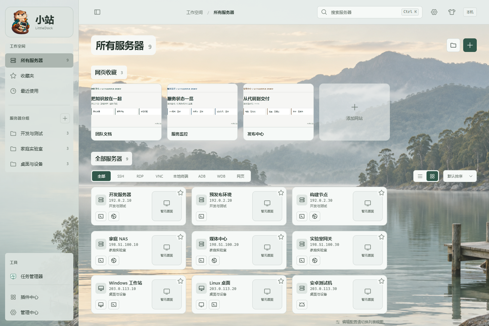
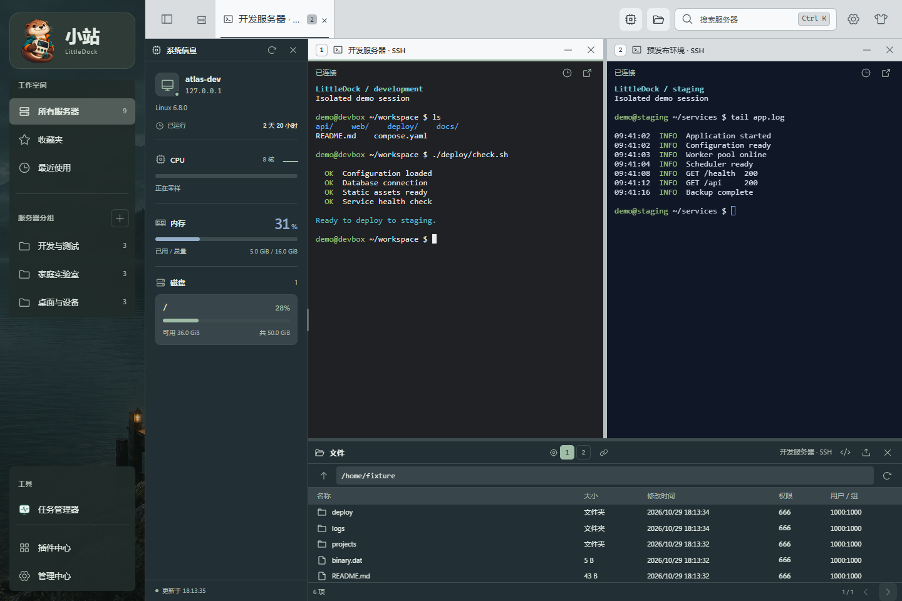
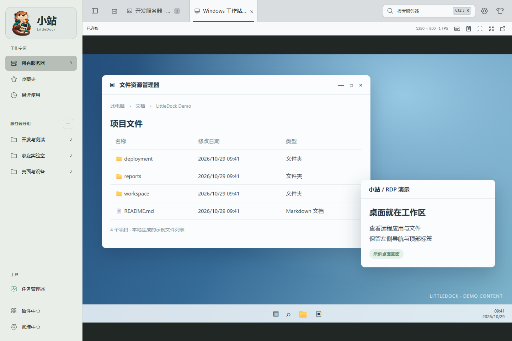
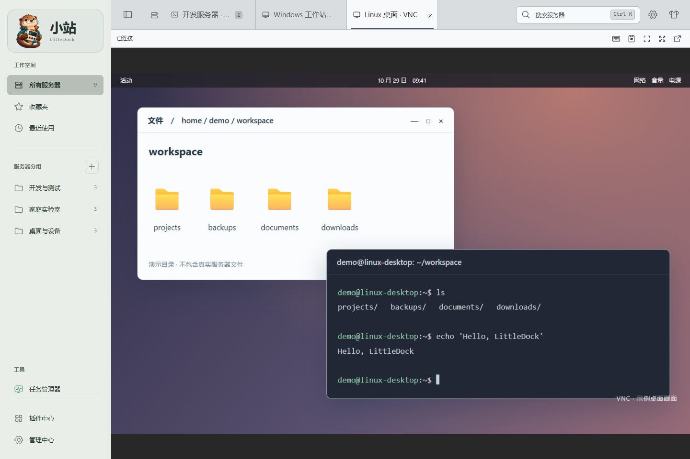
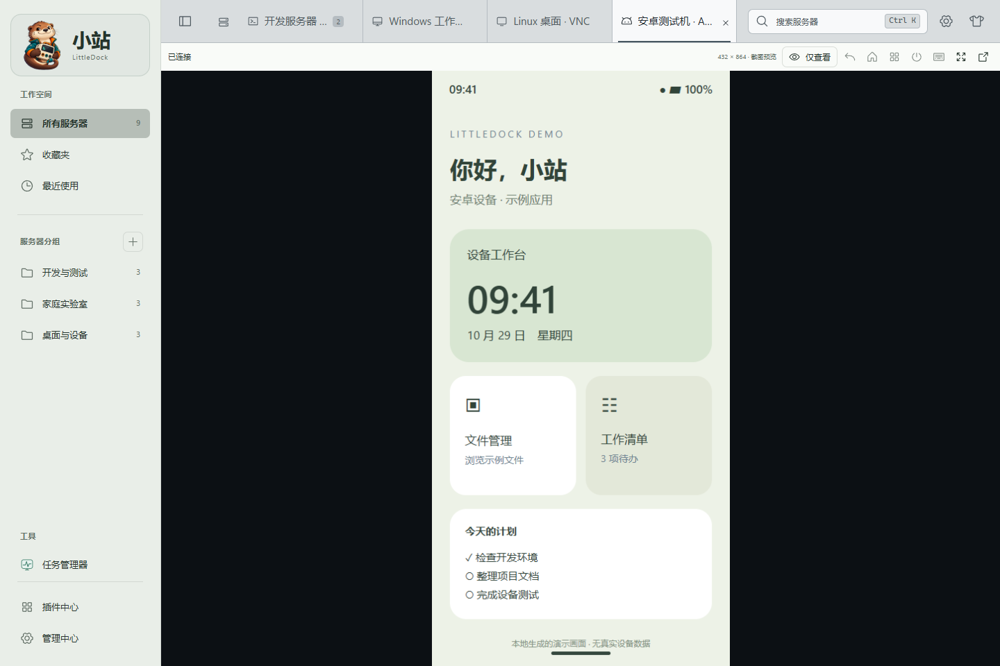
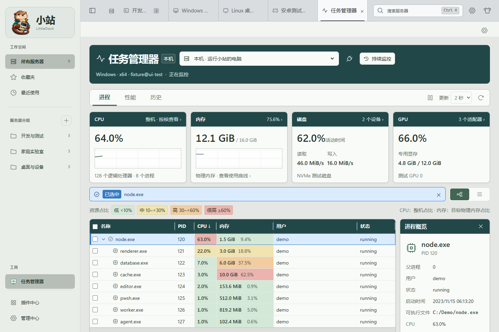
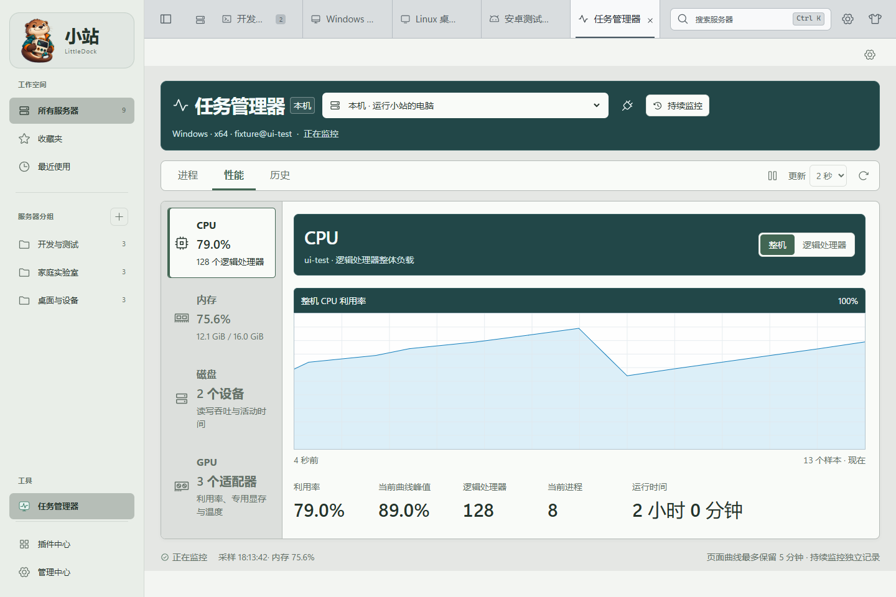
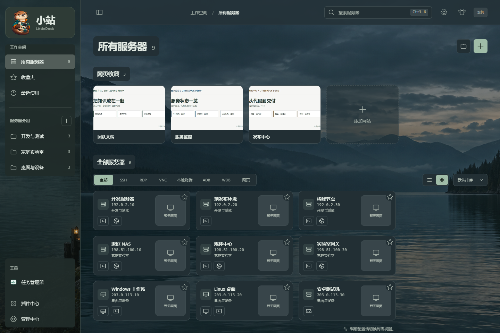
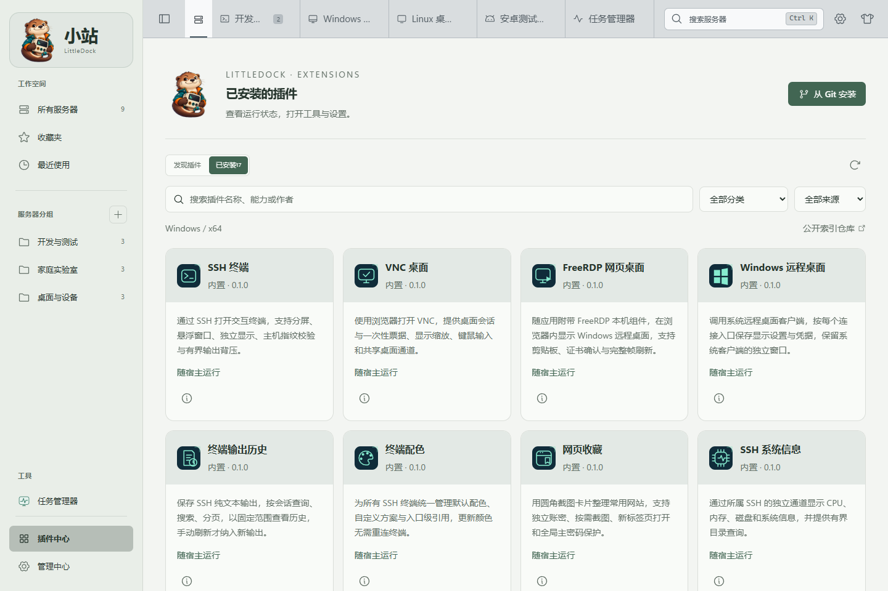

  

<h1 align="center">小站 · LittleDock</h1>

<strong>服务器、终端和常用工具，都放在你的小站。</strong>

运行在本机的个人连接工作台，打开浏览器就能开始工作。

  <a href="#快速开始">快速开始</a> ·
  <a href="docs/README.md">使用文档</a> ·
  <a href="https://github.com/xiongyu/littledock/issues">反馈问题</a> ·
  <a href="https://gitee.com/axisxy/webpagenav">Gitee 镜像</a>

截图来自隔离演示环境，名称、地址、桌面/手机内容及监控数据均为示例。首次运行为空目录。

## 能做什么

- **连接集中管理** — SSH、RDP、VNC、本地终端与 ADB / WDB，配合分组、收藏和搜索，快速找到目标。
- **终端用得顺手** — 多标签、嵌套分屏、悬浮窗口、独立配色和可搜索的输出历史。
- **文件就在手边** — SFTP 浏览与传输、在线编辑，也能打开远程 VS Code。
- **网站随手收藏** — 网页截图卡片，搭配浏览器扩展保存收藏、按授权填写账号密码。
- **按需要扩展** — 插件中心、任务管理器、主题与中英文界面；MCP 让 AI 在授权目标上工作，并支持人工接管。
- **工作台像自己** — 明暗主题、左右独立背景，以及静音循环的视频壁纸。

## 不用在窗口之间来回找

一边看终端输出，一边浏览文件、查看系统信息。连接可以分屏，也可以独立悬浮；切换布局时保留会话。

远程桌面、安卓设备和任务管理器也在同一个工作区里。点击图片查看大图。

| RDP · 网页远程桌面 | VNC · 桌面连接 |
| --- | --- |
|  |  |
| **安卓 · ADB 设备画面与控制入口** | **任务管理器 · 进程与资源占用** |
|  |  |

再看看性能曲线、深色主题与插件中心

**任务管理器** — 查看 CPU、内存、磁盘和 GPU，按需回溯历史。

**暮色归港** — 换一种适合夜间的工作氛围。

**插件中心** — 管理连接能力、工具和主题。

## 快速开始

当前主要验证平台为 **Windows x64**。准备 Node.js 和 pnpm；已验证版本为 Node.js 24.16.0、pnpm 12.4.2。

~~~powershell
git clone https://github.com/xiongyu/littledock.git
cd littledock
pnpm install
pnpm build
pnpm start
~~~

打开 **[127.0.0.1:3030](http://127.0.0.1:3030/)**，点击加号添加你的第一台服务器。Windows 下启动后驻留托盘，可从托盘打开、重启或退出。

开发模式使用 `pnpm dev`。环境配置、可选组件和故障排查见[安装与运行](docs/getting-started.md)。

## 数据留在本机

目录与凭据默认保存在当前用户的数据目录，服务仅监听 `127.0.0.1`。主密码、加密配置同步及浏览器扩展均按需设置。刷新或重新打开浏览器可接回同一后端运行期间的会话；后端或电脑重启后需要重新连接。

## 想了解更多

[SSH 与分屏](docs/terminal-workspace.md) · [远程桌面](docs/embedded-desktops.md) · [文件管理](docs/ssh-files.md) · [插件开发](docs/plugin-sdk.md) · [MCP / AI](docs/mcp-implementation.md)

使用方法集中在[文档导航](docs/README.md)；平台支持、已验证范围与历史测试记录见[验收记录](docs/validation-history.md)。欢迎通过 [Issues](https://github.com/xiongyu/littledock/issues) 提交建议或问题。
