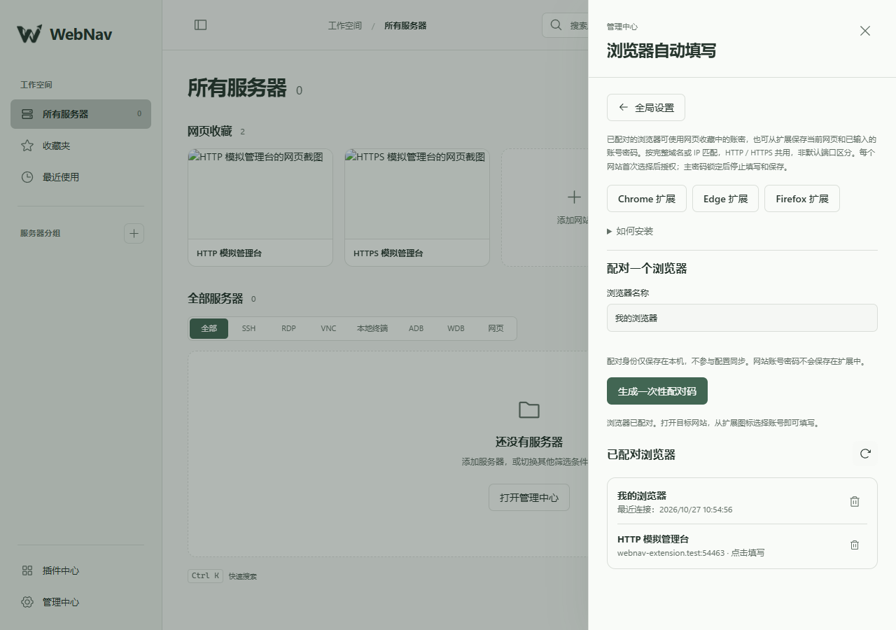

# 浏览器自动填写

小站扩展从当前电脑已运行的小站获取网页收藏账密，支持 Chrome、Edge、Firefox。扩展与后端只经 `ws://127.0.0.1:<端口>/ws/extension` 通信，无云端同步或外部数据服务。它不访问 SSH、RDP、VNC 或私钥。

## 安装与使用

运行 `pnpm build` 会构建三份扩展并打包；单独构建用 `pnpm extension:build`，`pnpm dev` 启动时也会生成下载包。生成目录为 `extension/dist/chrome`、`extension/dist/edge`、`extension/dist/firefox`，ZIP 为同目录上级的 `webnav-*.zip`。构建后也可从小站 → 右上角全局设置 → 浏览器自动填写下载。最低版本为 Chrome / Edge 121、Firefox 142。

- Chrome：打开 `chrome://extensions`，启用开发者模式，选择“加载已解压的扩展”，选中 Chrome 目录或 ZIP 解压后的目录。
- Edge：打开 `edge://extensions`，启用开发人员模式，以同样方式加载 Edge 目录。
- Firefox：当前产物未签名，打开 `about:debugging#/runtime/this-firefox`，临时载入解压目录中的 `manifest.json`。临时扩展在浏览器退出后移除。正式持久安装需通过 Mozilla 对该包签名，当前没有提交商店或执行账号签名。

在全局设置中为浏览器命名，生成两分钟有效的一次性配对码，粘贴到扩展弹窗。设置了主密码时，生成配对码需再次验证；此验证不延长解锁时间。每个浏览器配置文件单独配对，最多 16 个；取消、重新生成、页面离开或锁定后，待配对码失效。配对成功后可在设置中撤销整个浏览器或某个网站的授权。

在登录网页点击扩展图标，选择匹配账号，点击“允许并填写”。勾选“以后在此网站自动填写”后，浏览器会按需申请该主机的 HTTP/HTTPS 访问权限；以后打开该网站自动填写。该浏览器在同一网站只选一个自动账号，其他账号仍可点击填写。扩展不自动提交登录，不覆盖已有输入。

## 从网页保存收藏

0.2.0 新增“收藏当前网页”。在网站的登录框填好账密后，点击扩展图标 → 收藏当前网页；扩展读取当前标题、完整网址及可明确识别的可见登录框，显示可修改的预览，密码默认遮罩。点击“保存到小站”后，收藏和账密一起保存，首页自动更新。页面无需有已保存账号，也不需要先开通自动填写权限。

默认新增收藏；“保存到”也可选择同一域名/IP、同一非默认端口的已有收藏，并明确点击“更新这条收藏”。更新会核对读取时的记录版本，发生冲突需重新读取；已有账密不会回填到此预览。不勾选“同时保存账号密码”时可只收藏页面，更新已有收藏则保留其账密。没有明确登录框时可手动补充账密。保存不会顺带开通自动填写。

采集仅由扩展弹窗的明确点击触发，不监听键盘、登录提交或持续记录输入；页面脚本不能发起采集和保存。只读取顶层可见登录框，不读隐藏框、iframe、注册/多密码框或跨站表单。预览绑定标签页、完整页面 URL 和随机文档标识，刷新、跳转、锁定、断线或两分钟过期后失效，弹窗在下一次检查时清除账密（通常一秒内）；取消、关闭和保存结束也清除。后台只暂存有界的非秘密绑定信息，扩展持久存储不保存采集到的账密。登录后已跳转或清空的输入不会恢复，需要在提交前保存。

保存通过现有加密扩展通道执行，后端重新校验站点、网址、更新归属和版本，使用现有收藏/凭据事务及截图队列。操作 ID 防止重复写入，新收藏 ID 也保证同次请求不会因重试创建多条。保存结果不包含秘密；超时结果未知时须在小站核对，不自动重试。保存时其他扩展通道立即失效，发起写入的通道保留至应答，官方扩展收到应答后也主动关闭，下一次操作重新认证。

## 网址规则

按完整域名或 IP 匹配，忽略 HTTP/HTTPS 和路径、查询参数、片段。标准 HTTP 80 / HTTPS 443 端口归一为默认网站，其他端口严格区分：

| 收藏 | 当前网页 | 结果 |
| --- | --- | --- |
| `https://panel.example.com/login` | `http://panel.example.com/` | 匹配 |
| `http://192.168.1.10:8080` | `https://192.168.1.10:8080` | 匹配 |
| `http://192.168.1.10:8080` | `http://192.168.1.10:9090` | 不匹配 |
| `https://example.com` | `https://sub.example.com` | 不匹配 |
| `https://example.com` | `https://example.com.evil.invalid` | 不匹配 |

HTTP 和 HTTPS 没有不同的额外授权勾选。网址由标准 URL 解析器归一化；禁止 URL 内嵌账密及非 HTTP(S) 协议。浏览器网站权限本身不能按端口限制，因此后台和后端仍独立检查端口。

当前仅填写顶层页面的可见、可编辑、空登录框：一个密码框和可明确识别的账号框，或单个密码框。新密码表单、多个密码框、模糊账号框、隐藏框、iframe、跨网站/不同自定义端口的表单提交目标不填写。允许表单在同一网站 HTTP/HTTPS 间切换。复杂分步登录、封闭 Shadow DOM、验证码及通用网站适配器尚未实现。

## 授权和消息边界

`browserExtension` 是独立 Cordis 服务。普通网页继续使用现有 Cookie 和精确 Origin 鉴权；扩展通道不接受网页 Cookie 替代配对证明，也不能调用普通业务 RPC。

1. 管理页面经已鉴权的业务 WS 创建待配对身份，随机密钥为 256 位，待配对只保存在后端内存。配对码包含服务实例 ID、指定回环端点、配对 ID、随机密钥和到期时间，不放入 URL 或操作结果缓存。
2. 扩展通道升级检查精确 Host、路径以及 Chrome/Edge 或 Firefox 扩展来源格式。配对成功后绑定该扩展的实际 Origin，重连必须一致；缺失或 `null` Origin 拒绝。
3. 服务与扩展各生成 256 位随机挑战。HMAC-SHA-256 证明绑定协议版本、服务实例 ID、端点、扩展 Origin、配对 ID、双方挑战及证明方向。扩展也验证服务，不能仅凭端口相信对方。
4. HKDF-SHA-256 根据该次握手派生两条方向独立的 AES-256-GCM 密钥。每方向使用严格递增序号和 96 位 nonce，拒绝重复、乱序、篡改、反射及跨连接复用。密码和匹配信息都在认证加密消息内。
5. 连接最长 10 分钟，握手 10 秒超时，最多 16 个通道、每通道 8 条等待消息和 500 个请求；单帧 36,000 字节，输出缓冲 64,000 字节，心跳 20 秒。失联后按下一次明确操作或新页面重新认证，不重放填写或授权操作。

扩展后台通过浏览器提供的消息发送者和标签页信息确定真实页面；页面填写脚本只能申请已有自动授权，不能创建授权、配对或索取任意记录。手动授权仅接受扩展自身弹窗消息。后台再次确认目标标签页、实际 Origin、页面随机标识和授权代次；返回账密最多五秒有效，页面跳转、连接断开或锁定后的迟到响应丢弃。

后端每次独立检查匹配网站、记录版本、配对及网站授权、全局解锁。账密只返回所选的一条，不进入批量导出、订阅、日志或操作缓存。网站 URL 修改/删除会撤销对应授权；账号变更会关闭当前扩展通道，下一次重新取得记录版本。

## 保存和清理

后端 `extension_pairs` 保存身份元数据，`extension_grants` 保存每浏览器每收藏的域名/端口授权；`origin` 列在授权表中保存归一的网站匹配键，在配对表中保存实际扩展 Origin。配对密钥使用独立 `extension-key` 凭据记录，随主密码设置、修改、移除原子迁移；不进入配置同步和普通导出，也不被服务器目录替换删除。

扩展仅在自身 Origin 的 IndexedDB 持久保存配对信息和自动网站列表，不保存网站账号密码，不使用浏览器同步存储。实际填写的明文只短暂经过后台和目标页面脚本；用户主动采集的输入短暂显示在扩展保存预览中。填写后已成为网站表单内容，锁定不会擅自擦除用户表单。后台锁定、服务关闭或撤销身份时清理活动通道；普通页面“查看明文”仍沿用每次主密码验证。

防护目标是阻止普通网页、未配对扩展直接取密及消息重放，不包括已控制本机账户、浏览器或扩展自身代码的攻击者。回环限制只适用于扩展向小站获取数据，网站自身的登录提交仍使用网站协议。

## 验证

`backend/tests/browser-extension.test.mjs` 覆盖来源和 Host 拒绝、错密钥、扩展身份绑定、HTTP/HTTPS 共享匹配和端口隔离、网站授权、消息重放/篡改/反射、配对取消/过期、撤销和网址变更、主密码迁移/锁定/重启、同步排除、操作去重和敏感结果不缓存。0.2.0 增加加密保存、重复提交、跨网站/端口更新拒绝、记录版本冲突、非法账密不修改数据、只更新网页保留已有账密、保存应答与其他通道失效。`extension/tests/protocol.test.mjs` 覆盖 URL 归一、伪装域名及回环端点约束。

`backend/tests/browser-extension-browser.mjs` 使用隔离数据库、独立浏览器配置和本机 HTTP/自签名 HTTPS 模拟网站验证真实扩展配对、两种协议互相匹配、填写、刷新自动填写、已有输入保护、旧页面消息拒绝、隐藏框和跨网站表单拒绝、撤销停止、安装包下载及 390px 设置界面。该测试可通过 `WEBNAV_TEST_BROWSER` 指定兼容 Chromium 程序。`backend/tests/browser-extension-firefox.mjs` 通过 Mozilla 的 web-ext CLI 临时加载 Firefox 扩展，验证双向配对、HTTP 页面匹配 HTTPS 收藏、手动填写及刷新自动填写；运行前以 `WEBNAV_WEB_EXT_CLI` 指定其 `bin/web-ext.js` 路径。两套浏览器测试都在独立配置中将测试域名映射到本机，断言 HTTP 页不是安全上下文，避免回环 IP 的特殊待遇掩盖普通 HTTP 兼容问题；页面标识使用 `getRandomValues`，不依赖仅安全上下文可用的 `randomUUID`。

0.2.0 实际通过 Chromium 151.0.7922.34、Edge 156.0.4314.42 与 Firefox 158.0.1 验收。Chromium / Edge 额外验证了保存预览、取消清理、新增后首页即时订阅、更新已有收藏、仅保存网页、隐藏框不读取、页面不能发起采集、刷新及主密码锁定清理预览；Firefox 验证了读取已填表单、新增与更新。Firefox 测试会在刷新前清空测试表单，避免浏览器恢复已有账号触发扩展的不覆盖保护。类型检查、构建及 150 项自动化测试通过（后端 106、前端 42、扩展 2），Firefox web-ext 检查无错误、警告或提示。Chrome 156 的自动加载扩展方式未能启动扩展，尚未单独手动加载验收。Firefox 正式签名和商店发布尚未进行。

无头浏览器测试只在临时扩展副本中预授予本机测试主机权限，不改变发布包；浏览器权限确认气泡和各浏览器版本的完整安装 UI 仍需手动验收。未对真实远端网站执行登录。

[从网页保存的扩展弹窗，隔离测试数据](design/screenshots/browser-extension-save.png)

参考：[Chrome 内容脚本安全](https://developer.chrome.com/docs/extensions/develop/security-privacy/stay-secure)、[扩展 WebSocket](https://developer.chrome.com/docs/extensions/how-to/web-platform/websockets)、[Edge 扩展移植](https://learn.microsoft.com/en-us/microsoft-edge/extensions/developer-guide/port-chrome-extension)、[Firefox 后台差异](https://developer.mozilla.org/en-US/docs/Mozilla/Add-ons/WebExtensions/manifest.json/background)。
