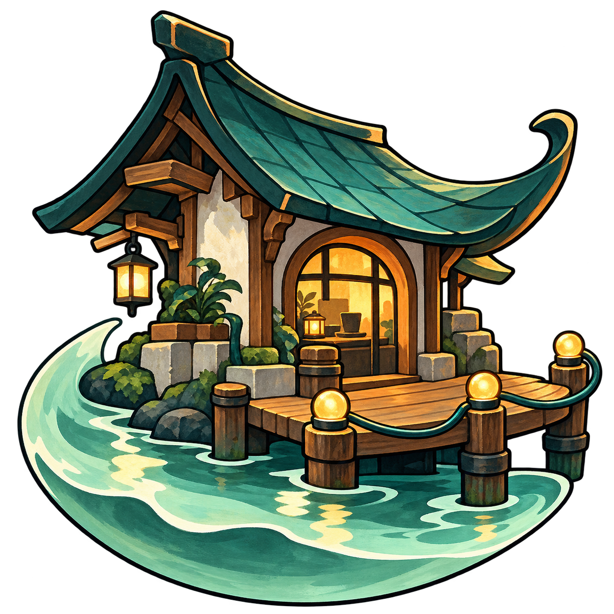
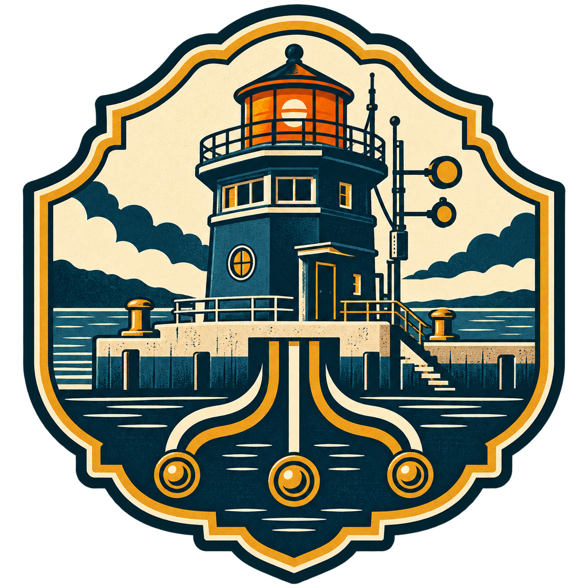
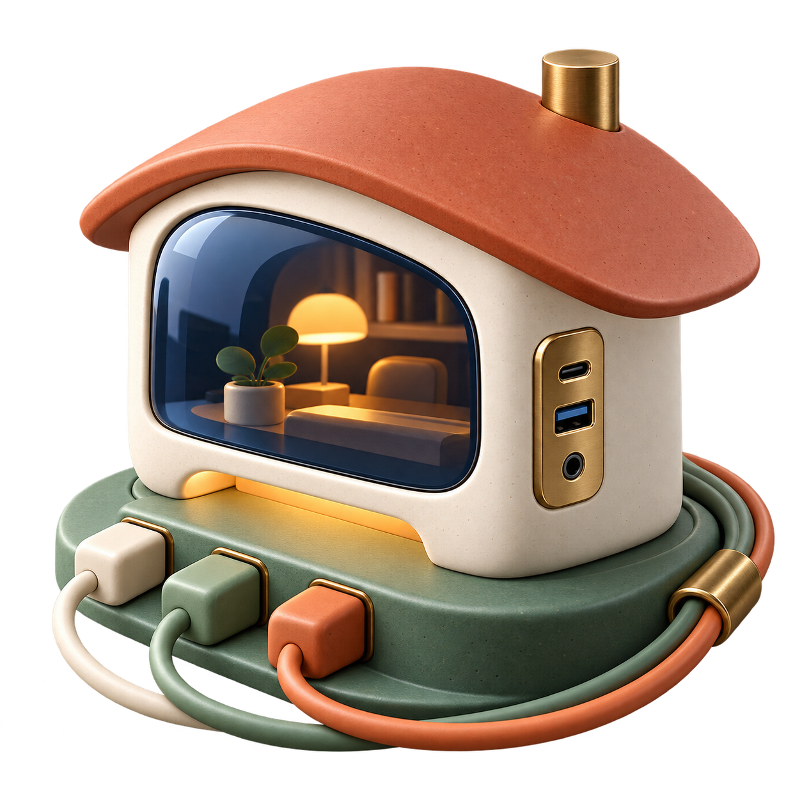

# 小站 · LittleDock：五版 Logo 风格探索

2026-10-29，根据「不要过于简约、增强辨识度、可尝试不同风格」的反馈重新生成。使用内置 imagegen，每款独立生成一张透明 PNG，不沿用 D/LD 字母造型。用户已选定 **5 号水獭管家**，作为小站的主标志和后续吉祥物形象；其他方案保留为探索记录。

| 编号 | 方案 | 方向 |
| --- | --- | --- |
| 1 | [灯火小站 · 温暖插画](01-warm-station.png) | 温暖的灯火、翘檐和小码头，最贴近中文「小站」的意象。细节丰富，适合品牌插画或较大的入口图标。 |
| 2 | [归港徽章 · 复古印章](02-retro-harbor.png) | 复古信号站与连接线路组成徽章，轮廓完整，偏沉稳、航海与工具组织感。 |
| 3 | [掌上工作站 · 立体微缩](03-miniature-dock.png) | 小屋、电脑与扩展坞合成一个立体工作站，直接表达「自己的本地工具小天地」。 |
| 4 | [深夜站台 · 像素游戏](04-pixel-night-stop.png) | 终端、插头和深夜站台结合，橙紫撞色，游戏感和开发者气质更鲜明。 |
| 5 | [小站管家 · 水獭吉祥物](05-otter-keeper.png) | 抱着终端工具箱的水獭管家，亲切且容易建立角色记忆，可延展为吉祥物。 |

5 号完整图已接入侧栏和扩展弹窗；以同一形象生成的头像版用于浏览器标签、扩展图标和托盘。正式资源与头像生成提示词见[品牌与主题](../littledock-brand.md)。

## 1. 灯火小站 · 温暖插画

温暖的灯火、翘檐和小码头，最贴近中文「小站」的意象。细节丰富，适合品牌插画或较大的入口图标。



## 2. 归港徽章 · 复古印章

复古信号站与连接线路组成徽章，轮廓完整，偏沉稳、航海与工具组织感。



## 3. 掌上工作站 · 立体微缩

小屋、电脑与扩展坞合成一个立体工作站，直接表达「自己的本地工具小天地」。



## 4. 深夜站台 · 像素游戏

终端、插头和深夜站台结合，橙紫撞色，游戏感和开发者气质更鲜明。


## 5. 小站管家 · 水獭吉祥物

抱着终端工具箱的水獭管家，亲切且容易建立角色记忆，可延展为吉祥物。


## 生成提示词

全部通过内置 image_gen 生成，参数 `transparent_background: true`；保留原始输出，不进行裁剪或重绘。

### 01-warm-station

```text
Use case: logo-brand. Create one memorable illustrated app logo symbol for 小站 / LittleDock, a personal local connection and tools workspace that gathers terminals, remote computers, bookmarks and plugins. Direction 1: a welcoming tiny lakeside station as a richly designed emblem, not a generic house icon. Three-quarter view, sculptural sweeping dark-teal roof with a distinctive upturned corner, warm amber arched window, a little landing platform that becomes a curved cable with three small illuminated connection nodes. A pale mint crescent of water cradles the building. Warm hand-painted editorial illustration, confidently inked irregular dark outlines, gouache-like flat color masses with a little tactile shading. Palette forest teal, warm ivory, ochre and coral accent. Recognizable compact silhouette, expressive and charming, moderate architectural detail, strong contrast. Centered square composition, emblem about 85% of canvas. The building and platform are the whole freestanding logo, not a landscape vignette. Genuinely transparent background and transparent open spaces. No words, no letters, no D or LD monogram, no generic power or WiFi symbol, no big background tile, no mockup, no caption, no watermark.
```

### 02-retro-harbor

```text
Use case: logo-brand. Create one distinctive retro emblem logo symbol for 小站 / LittleDock, a local connections and tools workspace: a place where all your computers and tools dock. Direction 2: a beautifully crafted vintage harbor signal-station badge, intricate enough to be recognizable and personal. A squat petrol-blue harbor signal tower with a bright burnt-orange lantern sits on an off-white wharf; three curving cable-like wave bands converge beneath it, ending in three clear brass round terminals along the lower rim. Bold die-cut shield silhouette with scalloped shoulders and a stepped base, thick double enamel border, subtle screen-print grain, flat cream and dark petrol shapes with ochre-gold accents, a little burnt orange. Strong 1970s transport sign and premium embroidered patch sensibility, graphic and confident rather than cute. Use meaningful organized interior detail and large high-contrast color fields. One badge centered, filling about 84% of square canvas, transparent exterior; the shield's ivory interior is part of the design. Absolutely no lettering, no numbers, no D or LD monogram, no anchor cliché, no stars around a seal, no mockup, no presentation grid, no cast shadow outside the badge, no watermark.
```

### 03-miniature-dock

```text
Use case: logo-brand. Design a single high-end 3D app logo symbol for 小站 / LittleDock, a personal local connection and tools workspace. Direction 3: an exquisitely crafted miniature docking station, an imaginative little building that is also a desktop computer. Isometric three-quarter view: a rounded cream-colored workstation cabin with a terracotta asymmetrical canopy, one large dark-glass blue screen-window, a warm light inside, and a tiny brushed-brass port panel on its side. Its small oval jade-green platform has three short chunky plug sockets docking into the edge, with a smooth cable loop curling around the foot. A warm tactile model made from matte ceramic, softly textured clay and restrained brass, precise studio lighting and soft self-shadowing. Sophisticated collectible design, a substantial physical object with delightfully specific details, not a generic toy computer or emoji. Distinctive silhouette and clear focal center, no clutter, enough detail to inspect at 256px. Square composition, object fills 85%, floating standalone with genuinely transparent background and no ground plane. No letters, words, numbers, D/LD, UI screenshot, large app icon background tile, mockup, watermark, or dramatic glow.
```

### 04-pixel-night-stop

```text
Use case: logo-brand. Create one original richly expressive PIXEL ART app logo symbol for 小站 / LittleDock, a personal connection and tools workspace. Direction 4: a cozy nocturnal computer station on a little docking platform, designed as a memorable game inventory emblem. A chunky purple-blue CRT terminal doubles as a tiny station building with an asymmetrical orange canopy; a luminous mint-green screen contains just three simple glowing square pixels, and two large connector ports sit at the foot. A winding electric cable wraps into the silhouette like a path and ends in a prominent orange plug. One small amber station lamp leans above the screen. High-quality intentional 64x64-style pixel construction upscaled with razor-sharp nearest-neighbor blocks; clear clusters, selective thick dark outlines, no antialiasing, no blur. Carefully limited palette of midnight navy, indigo, lavender, mint, orange and warm cream. Playful, richly characterized, high-contrast, distinctly different from flat vector logos. Compact balanced silhouette centered and filling 84% of a square transparent canvas. Genuine transparency around every outside pixel. No lettering, no D/LD monogram, no human characters, no landscape background, no large rounded square tile, no watermark or mockup.
```

### 05-otter-keeper

```text
Use case: logo-brand. Create one immediately memorable mascot app logo symbol for 小站 / LittleDock, a personal local connections and tools workspace, a welcoming little dock for computers and tools. Direction 5: a cheerful clever OTTER station keeper, shown chest-up with a large distinctive head, tiny rounded ears and three whiskers on each cheek. The otter wears a short petrol-teal harbor-worker jacket with warm orange lining, and cradles a chunky cream terminal-shaped toolbox: dark screen with two small mint light blocks, three round connection sockets. Its curled tail wraps around the lower silhouette into a little cable-like hook. Engaging calm confident expression, one eyebrow slightly raised, friendly but not childish. Bold contemporary character branding with lively dark navy outlines, caramel and cream fur, jade teal and vivid tangerine accents; expressive layered shapes and a touch of cel shading, polished sticker-quality illustration. Clear individual personality, asymmetrical silhouette, medium detail, no oversimplified abstract animal. One freestanding symbol centered on square canvas, fills 86%, genuine transparent background, no white sticker border. No words, letters, numbers, D/LD, background scene, large app tile, watermark or mockup.
```
