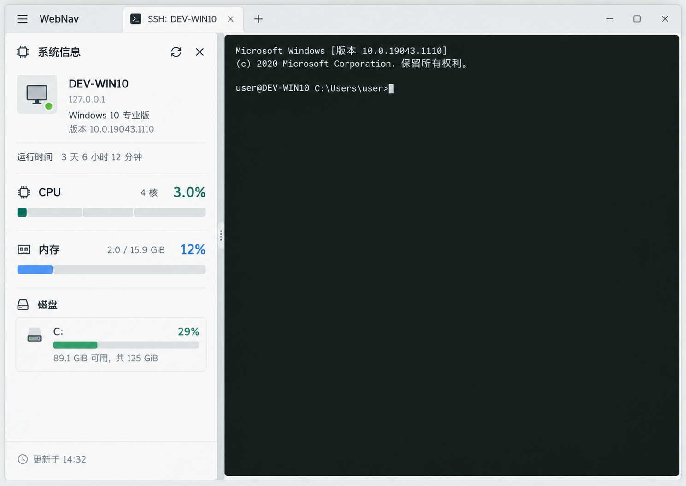

# 系统信息栏视觉参考

2026-10-26，使用内置 imagegen 生成参考，再以 Vue / CSS 实现。图片仅供布局参考，运行页面的指标来自实际 SSH 探测，不使用参考图中的数据。设计保留语义主题变量和固定终端字号。

## 生成提示词

Use case: ui-mockup. Create a high fidelity desktop SSH client screenshot concept, front-on flat UI, not a photograph. Focus on a beautiful compact 260px left system-inspector panel next to a dark terminal, in a total 1100x780 desktop frame. WebNav app, Chinese labels. Very quiet warm gray-white and pale sage, charcoal typography, restrained green and desaturated blue indicators, clean precise thin borders, no gradients, no neon, no decorative graphics. Upper light gray tab bar with a single SSH tab. Left inspector header: CPU micro icon, 系统信息, refresh and close icons. Host summary shows a small rounded computer icon with subtle green dot, 'DEV-WIN10', secondary IP '127.0.0.1', and a clearly readable two-line OS 'Windows 10 专业版'. Small uptime line. Below use an elegant single panel with 2 stacked compact metric rows: CPU with 4 核 and a prominent aligned 3.0%, understated horizontal segmented usage bar; 内存 with 12%, used/total '2.0 / 15.9 GiB', subtle blue usage bar. Below a small 磁盘 heading and a compact rounded disk row C: with 29%, capacity meter and free bytes. Balanced close spacing, excellent small-label hierarchy, no giant blank gaps between metrics, useful light footer showing 更新于 14:32. Right boundary is a 6px draggable divider with small mid-height grip. Right terminal dark near-black green, 13px monospace text 'Microsoft Windows [版本 10.0.19043.1110]' and 'user@DEV-WIN10 C:\Users\user>' near top left. Main navigation is collapsed. No charts with fabricated history, no rings, no dashboard tiles, no marketing cards. All app text stays compact and practical, style modern desktop developer tool. This is a design reference to implement in Vue/CSS; create one complete cohesive design.
