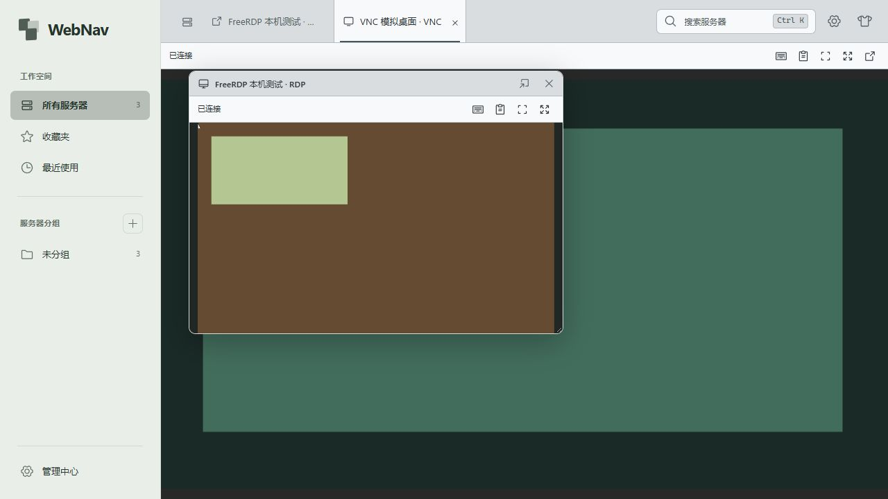

# 网页 RDP 与 VNC

## 使用

运行 `npm run dev`（或 `pnpm dev`），启动代码自动准备随项目附带的 Windows x64 RDP 组件。无需 Docker、WSL、guacd 或单独启动网关。生产构建后运行 `npm start`。

管理中心可添加 VNC 入口；RDP 的打开方式可选“网页内嵌”或“系统远程桌面”。新旧 RDP 入口均默认网页；旧入口省略 `rdpClient` 时直接打开内嵌标签，仅显式 `native` 调用 mstsc。无需批量改写目录、重新设置分辨率或重新保存密码。

网页桌面与 SSH 共用右侧标签，保留左侧导航、搜索与设置。支持悬浮、拖动、缩放、收回、全屏、适应窗口 / 原始大小、Ctrl+Alt+Delete 和手动文本剪贴板。切换展示方式复用连接，关闭标签才结束网页桌面；用户的 mstsc 独立运行。

RDP 按入口保存用户名、域、安全模式、证书策略和显示设置。网页默认固定 1920 × 1080，已保存的分辨率继续使用，最高 4096 × 2160；省略 `rdpDisplay` 的旧记录也使用默认 1080p，无需重写数据库。仅显式单屏全屏模式通过 Display Control 向支持的服务器请求跟随网页尺寸。浏览器全屏需用户手势；所有显示器模式仅支持系统 RDP。系统模式省略显示设置时保持客户端默认，200–8192 范围不变。

内嵌 RDP 只使用此入口在小站中保存的账密，不读取系统远程桌面的已存密码或证书确认记录，也不在失败时自动切换系统客户端。自动协商 / NLA 模式在发起连接前检查完整账密；在入口中填写并保存后，密码字段显示“已保存”，不回填明文。

默认自动接受并记住首次证书，包括旧入口未配置证书策略的情况；指纹一致时直接连接，无需弹出提示。证书变化时弹出“更新服务器证书？”：选择“更新并连接”保存新指纹并继续当前连接，取消或 Esc 停止连接，保留原指纹。确认等待最多两分钟，刷新后接回同一待确认请求，不重新计时；明确关闭桌面或超时才回收。只有用户明确选择“严格验证受信任证书”时才强制验证可信链。

VNC 默认端口 5900，支持 RFB 3.3 / 3.7 / 3.8 的无密码和经典 VNC 密码认证。经典密码使用前 8 个单字节字符；VeNCrypt、厂商扩展认证及云登录不在当前范围。后台恢复桥接目前使用 raw / DesktopSize / 光标无状态编码，不协商 Tight/ZRLE 压缩，带宽可能高于旧直通链路。支持本地缩放和服务器主动尺寸变更，不支持网页请求改变远端分辨率；画面限制为 4096 × 2160。

## 插件边界

```text
浏览器 noVNC ── /ws/desktop ── Cordis desktops ── TCP / RFB ── VNC
浏览器 Guacamole JS ── /ws/desktop ── Cordis desktops
                                      └─ FreeRdpPlugin ── stdin/stdout ── FreeRDP ── RDP
```

- `backend/src/plugins/rdp/index.ts` 是独立 Cordis RDP 插件，向连接器注册表注册 `rdp`，向公共桌面服务注册 RDP 画面提供器。系统模式交给已有 `rdp-native` 连接器。SSH 和系统 RDP 也通过各自 Cordis 服务注册；VNC 当前仍由公共桌面服务注册和管理。
- 公共 `desktops` 负责一次性票据、页面归属、WS、连接额度及关闭；RDP 插件负责 FreeRDP 适配和本机组件。插件中心切换实现时等待活动桌面结束，然后撤销旧注册并回收辅助进程；直接处置 Cordis 插件或退出宿主时仍立即清理所属网页 RDP，不影响用户的 mstsc。
- `WEBNAV_RDP_ENABLED=0` 禁用网页 RDP，环境变量变更需要重启，系统 RDP 仍可使用。内置 RDP 随应用构建并显示在插件市场，支持按公开契约在线替换，遵循 [插件生命周期](plugins.md) 的等待与待重启规则。
- Guacamole JS 仅保留为浏览器显示、键鼠、同步与文本剪贴板编解码器，不再连接 guacd。所有业务请求继续走 WS，没有新增 REST 接口。

## 本机组件

原生源码位于 `backend/native/rdp/src/main.cpp`。一个网页 RDP 会话对应一个隐藏的 `webnav-rdp-<hash>.exe` 进程，直接链接 FreeRDP 3.32.2、WinPR 和 OpenSSL 3.5.9。使用 Windows WIC 编码 JPEG / PNG，无额外图像服务。已开启 GFX / H.264 协商及 Windows Media Foundation 解码，实际采用的远端编码取决于服务器；AVC444 未开启。

当前链路为远端 RDP → FreeRDP 解码到像素缓冲 → 本机 JPEG / PNG → 网页解码绘制。启用 H.264 不代表浏览器接收 H.264 视频，也不保证端到端硬件解码或游戏帧率。主要优化目标是 1080p / 1440p 下减少本机桥接开销，4K 为可选尺寸上限，实际性能需分别测量。

`package/` 保存压缩后的 Windows x64 预编译程序、版本 / SHA-256 清单及上游许可证；`runtime/` 是忽略的解压缓存。启动和首次使用会校验、自动解压，不联网下载，不要求用户安装 C++ 编译器。按哈希命名可避免更新时覆盖正在使用的程序。其他平台的 SSH / VNC 可运行，网页 RDP 返回明确的当前平台不支持提示。

组件不监听本机网络端口。Node 通过二进制 stdin 传入保存的目标、账号密码和显示设置；认证信息不进入命令行、URL、目录响应、订阅、导出或浏览器。stdout 只传类型化画面 / 剪贴板记录，stderr 不进入普通日志。明确关闭桌面、取消连接、插件停止或后端退出会结束辅助进程；关闭显示 WS 只暂停画面发送，父进程意外退出时 stdin EOF 仍取消连接。

证书记录由小站独立保存在应用数据目录的 `rdp-certificates/`，不复用 mstsc 的确认记录。默认 TOFU 不会在证书变更时自动覆盖；变更确认绑定当前桌面通道及一次性请求 ID，确定后 FreeRDP 才更新记录。更新程序不能删除证书记录。严格模式使用 Windows 证书库验证可信链。

需要修改原生源码的开发者，准备 Visual Studio C++ Build Tools、CMake 和原生 Windows Perl（如 Strawberry Perl），运行：

```powershell
pnpm rdp:build
# 自定义 Perl 路径 / VS 版本，并编译仅用于测试的本机 RDP 服务：
powershell -File backend/native/rdp/build.ps1 -Perl C:/Strawberry/perl/bin/perl.exe -Generator "Visual Studio 18 2026" -TestPeer
```

构建脚本固定官方源码版本与 SHA-256，下载到忽略的 `.native-deps/`，静态链接后重新生成组件包。普通前端 / TS 修改不必重新编译原生库。更新 FreeRDP / OpenSSL 时应同步脚本、许可证、清单并运行本机协议测试。

## 会话与流量

- `connections.open` 只接收保存的服务器和入口 ID，后端读取凭据，再签发一次性绑定票据。浏览器不能从桌面通道指定新目标、命令或认证参数。
- 一页一个业务 WS，每桌面一个 `/ws/desktop`。业务或桌面 WS 断开不销毁内置后台桌面；同一浏览器重新打开取得新票据，接回同一远端连接。明确关闭、鉴权失效或后端停止回收资源，不重放输入；旧外部提供者须声明可选 viewer 能力才支持保留。
- 最多 4 个网页桌面、页面合计 8 个连接标签。票据 30 秒、辅助程序建连认证 25 秒；VNC 网页握手另限 10 秒。归属校验和重放保护保持不变。
- 等待证书更新确认时暂停建连倒计时，改用 120 秒确认期限；确认后恢复建连计时。显示断线可在剩余期限内接回；锁定禁止确认和重新绑定，超时、明确关闭、退出或插件停止释放待确认进程。
- RDP 原生记录头为两个小端 uint32（类型、payload 字节数），单记录至多 1 MiB。输入按操作验证：键、鼠标、尺寸、文本剪贴板、同步确认和关闭，不提供任意命令入口。
- FreeRDP 保留当前帧缓冲和最多 144 个脏区标记（4096 × 2160 的一屏，每格 256 × 256）。同一次刷新中的全部图片发送完毕后才发送一个 `sync`；网页等本帧全部图片解码后一起绘制，再回复显示 ACK，不按几张瓦片反复等待往返。
- 变化像素累计超过 16,384 时，将变化范围编码为质量参数 0.85 的 JPEG；其余小变化按格内实际矩形编码无损 PNG，避免放大成整块。JPEG 图像超过单记录上限会继续拆分，仍属于同一帧。静止约 250 ms 后补一帧全屏 PNG 精修，以恢复文字与细节。
- JPEG 变化范围超过 1280 × 720 时使用四个常驻编码线程处理四个象限，工作队列至多四项；全部来自同一锁定的像素缓冲，结束或异常时先等读取任务完成再释放画面。没有后台截图积压。远端数据、输入和 ACK 使用事件唤醒，不用固定轮询人为限制帧率。
- 同时最多两帧等待 ACK，以重叠本机编码、网页解码与呈现。单帧解码图片覆盖量至多一屏，两帧在途图片最高约 67.5 MiB 的 RGBA 像素量，实际还需画布、解码器和传输缓冲空间，不能将此数值当作进程内存上限。等待时继续接收远端变化，合并到当前像素缓冲和固定大小的脏区标记；ACK 校验对应序号并释放该帧及更早在途帧，随后发送最新变化。30 秒无 ACK 结束连接。隐藏标签仍受相同解析与背压限制。
- Node 将单张 JPEG / PNG 的 `img/blob/end` 合并成一个有界输出块，减少 WS 消息与回调；不在 Node 聚合整屏图片。原生记录先验证至多 1 MiB 的长度，再一次分配并线性复制分片，避免反复拼接大图片。浏览器增量解析只保留当前未完成指令，不保留已处理的整段流。
- 图片传输使用共享的有界解析器与码点计数，不调用会保留完整消息历史的第三方 Parser，也不为每段 base64 创建字符数组。Guacamole 的 ImageBitmap 生命周期通过仓库内 pnpm 补丁管理：绘制、取消及取消后才完成的解码均释放位图。GFX 绘制线程单独唤醒发送循环，画面读取与图形通道初始化、销毁使用一致的锁顺序。
- Node 使用流暂停 / 恢复和 WS 发送回调；发送队列超 4 MiB 移除显示视图。输入单帧最多 64 KiB、每秒及待写缓冲最多 1 MiB。额度是实现限制，不代表已完成最大尺寸、多会话容量或性能验收。
- 文本剪贴板至多 64 KiB，手动发送 / 查看；不访问本机 OS 剪贴板，不支持文件剪贴板。前端关闭、锁定或断线清理面板。桌面密码参与统一主密码迁移，表单不回填秘密；全局锁定阻止新建 / 绑定，不强行断开已认证桌面。
- 每 5 秒从真实网页画布采样缩略图，停止后保留最后一帧，仅存本页内存。见[卡片预览](session-preview.md)。支持同一后端运行期内的[后台会话恢复](persistent-sessions.md)，没有远程录像，也不写入 SSH 输出历史。

原生 viewer 命令编号 9，payload 为 uint32 代次和启用标记；事件 11 回报相同代次。脱离时释放输入、暂停编码并清除旧 ACK；附着时重发尺寸、完整画面及光标，Node 丢弃旧代次数据。无网页期间不等待显示 ACK，不积压截图；有网页时仍遵守两帧在途及原生三十秒无 ACK 超时限制。后端退出无法复活同一 RDP/VNC 连接。

不包含音频、文件传输、驱动器 / 打印机 / 智能卡重定向、网页多显示器和移动端专用键盘。

## 刷新性能对比

桌面工具栏显示实际协商的宽高，以及最近一秒完成网页绘制并回复 ACK 的帧数。静止桌面不需要重复发送相同图片，因此可以显示 0 FPS。悬停可查看远端 GFX 帧率（未使用 GFX 时为绘制更新次数）、本机桥接处理时间、网页呈现时间和浏览器调度频率。桥接耗时包含画面锁等待、编码与管道输出；网页呈现从本帧首张 `img` 指令到绘制 ACK，包含后续图片接收与解码等待。它们不是网络往返或鼠标到画面的端到端延迟。

2026-10-26 的组件运动基准使用本机测试 RDP 服务，以约 60 Hz 连续刷新彩色方格，每个分辨率持续约 5 秒，模拟客户端在 `sync` 后延迟 16 ms 回复 ACK。该测试覆盖 FreeRDP 接收、合并、编码和管道输出，**没有浏览器解码、绘制或实际游戏**：

| 分辨率 | 组件输出更新/秒 | 本机桥接耗时 P95 |
| --- | ---: | ---: |
| 1920 × 1080 | 59.7 | 5.127 ms |
| 2560 × 1440 | 64.2 | 6.593 ms |
| 3840 × 2160 | 58.8 | 15.360 ms |

此模拟服务使用传统 RDP 绘制指令，同一场景变化可能分多次提交，所以组件更新次数可以超过场景的 60 Hz；不能据此宣称网页或远端游戏达到 60 FPS。超过 720p 的变化范围启用四路编码；编码内容与负载也影响耗时。真实网页帧率、远端复杂场景和多会话容量需单独验证；组件基准不构成这些性能的承诺。

同日使用独立浏览器测试页连接上述运动场景，直接读取绘制 ACK 计数：1080p 观察到约 60 FPS，1440p 约 55 FPS，4K 约 33 FPS（浏览器调度约 60 次/秒）。这些是当前机器的短时观察值，不是标准化的长期平均值。修复前同一 1080p 页面只有约 18–23 FPS；原因是第三方消息解析器累积已处理文本。本轮消除了该问题，但 4K 网页整条链路仍低于组件单独测试，**尚未达到 4K 60 FPS，也不能宣称所有场景都没有桥接瓶颈**。

网页复现：运行 `node --experimental-strip-types backend/tests/desktop-ui-fixture.mjs`，打开输出的本机地址，分别选择 RDP（默认 1080p）、2K、4K；聚焦桌面按 F8 开关运动。停止前关闭测试桌面，再在输出的临时目录创建 `stop` 文件。该夹具使用独立数据库，不导入用户真实目录。截图：[1080p](design/screenshots/rdp-motion-1080p.png)、[1440p](design/screenshots/rdp-motion-1440p.png)、[4K](design/screenshots/rdp-motion-2160p.png)。

复现命令（需先构建 `-TestPeer`，测试仅使用临时目录与回环地址）：

```powershell
node --experimental-strip-types backend/tests/rdp-render-bench.mjs
# 持续运动基准：1080p、1440p、4K，各约 5 秒
node --experimental-strip-types backend/tests/rdp-render-bench.mjs --motion
# 可传入另一个已构建版本的辅助程序，比较相同测试场景：
node --experimental-strip-types backend/tests/rdp-render-bench.mjs C:/path/to/webnav-rdp.exe
```

原生回归还验证：第一次 `sync` 前已覆盖整屏；最多两帧未确认，额度耗尽后连续触发十次服务端重绘不会无限追加；恢复 ACK 后发送最新画面并在静止后无损精修；跨格边界的 20 × 20 小更新只发送 400 像素；4K 四路 JPEG 合起来覆盖整屏；关闭管道后回收程序。测试服务 F6 全屏重绘、F7 局部重绘、F8 开关连续运动只用于开发验证，不随运行组件发布。

帧边界与确认语义参照 [Guacamole 官方 sync 约定](https://guacamole.apache.org/doc/gug/protocol-reference#sync)；当前安装的客户端在帧内图片就绪后统一执行绘制，再发送确认。

浏览器回归通过真实 FreeRDP 连接本机测试服务，先执行全屏改色，再执行右下角 20 × 20 局部更新；截图中的色块为测试图案，见[刷新验证截图](design/screenshots/rdp-frame-refresh.png)。

## 验证边界

协议集成测试使用隔离数据目录、本机模拟 VNC 服务和注入的 RDP 提供器；原生连接测试使用仅监听 `127.0.0.1` 的测试 RDP 服务。测试结果不能当作用户真实 Windows 主机、域账号、NLA、多屏或长期吞吐验收。测试不连接用户保存的远端服务器。

2026-10-26 在 Windows x64 验证：类型检查、生产构建、前端 31 项与后端 43 项测试通过。原生 TLS 测试实际调用附带的 FreeRDP 程序，覆盖严格校验拒绝 / 默认首次信任 / 变更确认的取消、更新、更新后记忆与等待期间断开、PNG 画面、同步 ACK 限流、Ctrl+Alt+Delete 扩展键、鼠标、双向 Unicode 文本剪贴板和管道关闭回收。插件卸载测试确认 RDP 回收且 VNC 注册保留。原生 TLS 集成测试需要开发者使用 `-TestPeer` 构建测试服务，否则明确跳过；其他测试仍可运行。

浏览器验证 FreeRDP 与 VNC 同时显示、悬浮 / 收回不重连、关闭释放并保留最后画面。下图是本机测试服务生成的色块，并非真实 Windows 远端登录。动态分辨率、域账号兼容性与长期多桌面性能仍待进一步验收。

本轮另外按用户指定仅连接“牧师”真实入口，使用小站保存的独立账密登录，保留该入口已有的 1366 × 768 设置，确认资源管理器打开与窗口拖动后画面正常更新，并观测到 GFX 帧计数。没有修改远端显示策略、运行游戏或把短暂拖动当作持续游戏帧率测试。真实验证截图保存在本机临时目录，未进入仓库。

补充回归：省略 `rdpClient` 的旧入口在后端重启后返回网页会话和绑定票据，沿用分辨率、凭据且不调用系统启动器；前端点击直接出现标签与画面，不需要先编辑保存。浏览器使用同样缺省字段的本机测试入口验证，见[默认内嵌截图](design/screenshots/rdp-default-embedded.png)。

错误反馈回归：浏览器通过真实 FreeRDP 连接本机自签名测试服务，证书被拒绝后立即显示具体错误并结束连接，不再等待前端超时，见[错误反馈截图](design/screenshots/rdp-error-feedback.png)。通过管理表单保存测试账密后，数据库值匹配，重新编辑显示“已保存”；跨重启读取及向连接器传递密码由集成测试覆盖。后续已按用户指定使用小站保存的账密完成一台真实 Windows 目标的内嵌登录，并在浏览器确认真实桌面画面；未读取或迁移系统客户端密码。真实目标截图只保留在本机临时目录，不进入 Git。



参考：[FreeRDP 3.32.2 源码](https://github.com/FreeRDP/FreeRDP/tree/3.32.2)、[OpenSSL 3.5.9](https://github.com/openssl/openssl/releases/tag/openssl-3.5.9)、[noVNC API](https://github.com/novnc/noVNC/blob/master/docs/API.md)、[RFB 标准](https://www.rfc-editor.org/rfc/rfc6143.html)、[Guacamole 显示协议](https://guacamole.apache.org/doc/gug/guacamole-protocol.html)。

浏览器证书回归使用本机测试服务更换自签名证书：取消后连接结束；再次连接并选择更新后显示画面，随后连接无需再次确认。见[证书确认截图](design/screenshots/rdp-certificate-confirm.png)。
