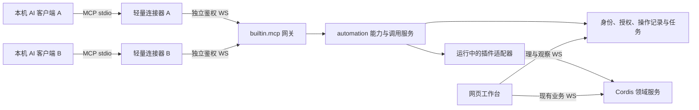

# MCP 工作台与插件自动化能力设计

状态：原始设计，2026-10-27；首版已进入实现。当前工具、协议、额度、使用方式和实测边界以 [MCP 实施说明](mcp-implementation.md) 为准。本文保留设计过程及后续目标，不将所有规划工具描述为已实现。

## 1. 目标与推荐决策

让小站成为人和 AI 共用的本机工作台：用户在工作台维护服务器、连接、凭据与插件，插件作者只实现一次自动化能力，不同 AI 通过同一个 MCP 接入方式发现并使用这些能力。工作台负责执行、权限、任务和结果，AI 负责理解需求与组织步骤。

推荐采用 **可选能力声明 + 宿主能力注册服务 + 内置 MCP 网关插件 + 轻量本地连接器**。不内置模型、不要求填写模型 API Key，也不为每种 AI 重写业务插件。

关键决定：

- 保留现有必填 `capabilities`，新增可选 `automation`。前者是服务/连接器装配契约，后者是 AI 可调用动作；缺省或 `tools: []` 都合法。
- 每个内置插件补齐“AI 能力与边界”说明；有稳定后端动作的插件逐项声明，纯外观等插件可以明确没有可调用工具。第三方插件选择是否接入。
- 插件声明、实际注册、当前运行、客户端授权四项同时成立，工具才可调用。只写说明不会自动产生执行能力。
- 首期用标准 MCP stdio 连接本机 AI，连接器通过独立、已鉴权的内部 WS 访问常驻后端，保留当前 WebSocket 业务边界。
- AI 使用自己的身份、连接和任务，不借用网页 Cookie，不向用户原有交互终端注入命令。AI 新建的 SSH 终端进入同一工作区，标签带 AI 标记，默认供人只读查看；人手动解锁后可接管同一终端输入。
- 能力扩展和权限集中在工作台维护；每个 AI 客户端仍需要首次添加一次 MCP 入口。新增业务插件无需逐个 AI 再配置，部分客户端可能需要刷新工具列表或重连。

## 2. 现有代码中的接入条件

| 现状 | 设计影响 |
| --- | --- |
| [插件清单](../shared/src/plugins.ts)的 `capabilities` 用于服务替换、连接器和主题；现有插件都依赖该字段 | 不改变旧字段含义，不把所有 service 方法自动公开 |
| [插件 SDK](../backend/src/plugin-api.ts)与[加载器](../backend/src/plugin-system/runtime.ts)已有注册、依赖和清理入口 | 增加显式自动化注册，不另起一套插件市场或插件安装器 |
| 内置清单位于 `backend/plugins/`，实际服务由 [app.ts](../backend/src/app.ts)装配 | 内置插件需要对应的运行时适配器，仅改清单不够 |
| [网页身份](../backend/src/plugins/auth.ts)与 SSH owner 绑定浏览器会话 | 增加独立调用主体与资源租约，不能把 AI ID 填进旧 owner 冒充浏览器 |
| [SSH create/attach](../backend/src/plugins/sessions.ts)先签发 30 秒票据，绑定终端 WS 才建立 SSH；桌面/设备也依赖专用 WS | 现有 `connections.open` 不能直接充当无界面的 AI 连接接口 |
| [SFTP](../backend/src/plugins/ssh-files/index.ts)和[系统探测](../backend/src/plugins/ssh-inspector.ts)依赖已绑定的 SSH | 独立文件操作与探测前，必须补充后端连接租约 |
| [transport](../backend/src/plugins/transport.ts)集中持有派发、部分预算和十分钟内存去重记录 | 领域服务入口要承接共用的校验/限额；不能绕开 transport 后丢掉这些约束 |

工作树已有 provider 生命周期、运行版本和待生效状态相关代码；本文不改变现有启停策略，也不把待生效的安装配置当作正在运行的能力。能力目录以实际运行快照为准。

## 3. 架构与传输



职责划分：

| 部件 | 职责 |
| --- | --- |
| `automation` 宿主服务 | 校验和注册能力、主体与范围检查、provider 绑定、调用预算、去重与任务协调；属于不可替换的安全基础设施 |
| `builtin.mcp` 插件 | 开启/关闭 AI 接入，提供独立 WS 接入与能力目录；通过 `extension:mcp@1` 表示宿主扩展，不冒充可替换业务服务 |
| 本地 `webnav-mcp` 连接器 | 标准 MCP 协议编解码、版本适配和内部 WS 连接；随宿主发布，不保存一份服务器目录，不自行解密业务凭据 |
| 插件自动化适配器 | 将已声明工具绑定到本插件的受控业务动作，与网页共享领域校验和事务 |
| AI 接入设置 / 任务面板 | 接入配置、授权模板、调用记录、运行任务、待处理确认和停止操作 |

桥接器与后端进行内部协议版本协商，版本不兼容时明确报错。后端未运行时提示启动工作台；首版不偷偷启动第二个后端。连接器关闭不退出常驻工作台；多 AI 只有各自轻量连接器，共用一套数据库、配置与后端服务。

### 传输选择

| 方案 | 本方案安排 |
| --- | --- |
| MCP stdio → 本机 WS | 首期采用。适合支持本地 MCP 进程的 AI；不会新增 HTTP 业务接口。stdout 只输出 MCP 消息，诊断走 stderr |
| 标准 Streamable HTTP | 后续有 HTTP 客户端需求时补充。作为显式外部 MCP 协议边界，单独设计鉴权并同步 HTTP 约定；网页业务仍使用 WS |
| 自定义 MCP WebSocket | 不要求 AI 支持。WS 只属于随附连接器与工作台之间的私有协议 |

`/ws/automation` 是拟新增的内部通道，仍只监听 `127.0.0.1`、检查 Host。该路径使用独立 AI 认证；原 `/ws`、终端、桌面和扩展的 Cookie/Origin 校验保持原样。浏览器发来的 Origin 不允许借此路径访问；无 Origin 的本地连接器也必须完成独立认证，不能因其来自回环就放行。

截至设计日期，官方当前 MCP 版本为 `2026-07-28`，与 `2025-11-25` 及更早版本的初始化方式不同。实现时选择并锁定支持目标协议的官方 SDK；计划验证当前版本与 `2025-11-25` 兼容模式，协议差异放在连接器，不传播到每个插件。参见[官方版本说明](https://modelcontextprotocol.io/docs/2026-07-28/learn/versioning)、[stdio](https://modelcontextprotocol.io/specification/2026-07-28/basic/transports/stdio)和 [Streamable HTTP](https://modelcontextprotocol.io/specification/2026-07-28/basic/transports/streamable-http)。

“各类 AI 接入”首先指可运行本地连接器的客户端。纯云端 AI 无法直接访问这台电脑的 `127.0.0.1`；远程中继、穿透和公网监听不属于首版，也不能承诺添加本地 URL 后云端就可使用。

## 4. 可选能力声明与插件 SDK

在 `webnav.plugin.json` 新增可选 `automation`，静态声明是描述的唯一来源，运行时只注册实现。下面是拟议格式片段，不是当前已支持的清单：

```json
{
  "capabilities": [{ "id": "service:sshFiles", "version": 1 }],
  "automation": {
    "schemaVersion": 1,
    "description": "在授权的 SSH 连接与路径范围内管理文件。",
    "tools": [{
      "id": "listDirectory",
      "version": 1,
      "contract": { "id": "ssh.files.list", "version": 1 },
      "binding": { "kind": "service", "capability": "service:sshFiles" },
      "title": "列出远端目录",
      "description": "分页返回目录条目，不读取文件正文。",
      "inputSchema": {
        "type": "object",
        "properties": {
          "serverId": { "type": "string" },
          "connectionId": { "type": "string" },
          "path": { "type": "string", "maxLength": 4096 },
          "cursor": { "type": "string" },
          "limit": { "type": "integer", "minimum": 1, "maximum": 200 }
        },
        "required": ["serverId", "connectionId", "path"],
        "additionalProperties": false
      },
      "outputSchema": {
        "type": "object",
        "properties": {
          "entries": { "type": "array", "maxItems": 200, "items": {
            "type": "object", "properties": {
              "name": { "type": "string" },
              "kind": { "enum": ["file", "directory", "link", "other"] }
            }, "required": ["name", "kind"], "additionalProperties": false
          } },
          "nextCursor": { "type": "string" }
        },
        "required": ["entries"],
        "additionalProperties": false
      },
      "access": "read",
      "scopes": ["ssh.files.read"],
      "execution": "request",
      "requires": ["vaultUnlocked", "sshConnection"],
      "limits": { "timeoutMs": 15000, "maxResultBytes": 262144 }
    }]
  }
}
```

除名称、描述、输入/输出 schema 外，工具应声明 `version`、`access`（read/write/execute/control）、`scopes`、`execution`（request/job）、运行前提和限额。特殊动作可声明破坏性或外部交互提示，供网关映射 MCP annotations；这些提示不能替代后端权限判断。工具描述和 schema 对应 [MCP Tools](https://modelcontextprotocol.io/specification/2026-07-28/server/tools)。

声明是数据：禁止远程 schema 引用、动态表达式和可执行校验代码，限制工具数量、schema 大小与深度。静态读取在安装确认前完成，不执行仓库代码。输入和输出都运行时校验，限额取宿主上限、授权策略与插件声明中的最严格值。

拟增加 SDK：`api.registerAutomationTool(toolId, handler)`。首版同一插件内每个 toolId 只允许一个当前版本，handler 绑定静态声明的 version；并行保留旧版需使用不同 toolId。handler 接收已校验参数，以及宿主提供的 principal、资源范围、operationId、取消信号与受控任务接口。禁止调用者在参数中伪造 owner、provider 或确认结果；输入业务对象仍需领域层验证。返回结构化业务数据，不直接操作 MCP socket。

- 缺省 `automation`：不注册自动化工具，插件照常工作。
- `tools: []`：明确不提供执行能力，可保留说明；纯主题不因此获得执行入口。
- 已声明但缺少 handler：工具不可调用，插件中心显示错误；不让单个自动化适配错误阻止网页原功能运行。
- 未声明的 handler、名称冲突或不兼容 schema：拒绝自动化注册，不生成兜底任意执行工具。
- 旧宿主仍可运行原有插件逻辑；使用新 SDK 的插件声明最低小站版本，或检测 API 后退回网页功能。新增字段被旧解析器忽略不等于自动化能力生效。

### 名称、provider 与版本

内部主键为 `(pluginId, toolId, toolVersion)`。宿主为常用能力定义少量明确、可测试的工具契约，例如 `webnav__ssh_files_list`；只有实现该契约并通过校验的当前 provider 才能承接。替换插件没有相应自动化适配时返回不可用，不悄悄绕过替换选择调用内置插件。

`contract: { id, version }` 可选，用于声明遵循某项宿主标准工具契约；`binding` 指明 service、connector 或 plugin。service/connector 必须指定对应 capability，并与插件原有 `capabilities` 匹配；省略 binding 时按插件自有工具处理。标准契约的 schema、权限下限和语义由宿主定义并校验，不能只凭自报 ID 取得标准路由。服务绑定检查当前 provider，连接器绑定按已保存目标解析，插件自有工具保留独立命名空间。

插件自有工具使用宿主生成的稳定命名空间，名字只用 MCP 允许的字符，限制长度并检测碰撞；插件不能占用宿主保留名称。不要提供 `callRpc(method, params)`、`invokeService(name, method)` 或只收自然语言的万能工具。

目录来自运行时注册表，区分已安装、待生效、已运行与当前可调用。服务工具跟随实际运行 provider；连接器工具跟随已保存入口的 provider 选择。每次调用捕获并校验 provider、提交/内置版本、工具版本和运行代次，任务全程持有对应资源租约。

工具列表按客户端权限过滤并稳定排序、分页；授权撤销立即阻止调用，不等待客户端更新列表。按协商的 MCP 版本发送目录变化通知；不支持变化通知的客户端重新列举。权限不足的工具不公开，临时锁定等前提用状态说明和调用错误表达。升级新增动作或扩大 schema/范围必须重新评估授权，不能沿用旧授权静默扩大权限。

## 5. AI 接入、授权与工作台体验

右上角全局设置增加“AI 接入”，`builtin.mcp` 在插件中心提供同一设置入口。用户启用后创建接入身份，复制不含业务凭据的配置；各 AI 首次添加同一连接器入口即可。新增能力由工作台发布，AI 无需保存 SSH 密码、私钥、服务器清单或针对每个插件安装脚本。

一个授权模板可以供多个客户端身份引用，例如“指定开发分组：读取状态与日志，修改指定目录”。每个客户端有独立身份和可撤销凭据，不能依赖 MCP `clientInfo.name` 判定身份，也不能所有 AI 共用一个无法区分来源的万能 token。

初次注册从可信工作台页面发起；一次性配对码绑定注册请求、限时消费。连接器保存独立密钥于当前用户受保护位置，后端登记公钥；后续连接用带服务身份校验与防重放的挑战认证，再建立短期认证上下文。身份、模板和撤销信息持久化，密钥不放命令参数、URL、插件公开配置、普通导出或配置同步。该协议独立设计和验证，不借用浏览器扩展的身份或密钥。

权限交集为：**客户端授权模板 ∩ 目标对象/路径 ∩ 当前插件/工具版本 ∩ 全局解锁状态**。读取目录、日志和文件也属于数据访问，需要对应授权。文件路径权限需处理规范化、符号链接及校验与打开之间的竞态；SFTP 无法可靠保证的隔离不得宣称为沙箱，应结合远端专用账号权限。

目标统一使用 `serverId + connectionId`，或宿主发放的无歧义 targetRef；当前入口 ID 只在单台服务器内部唯一。授权、预览和租约绑定该二元组、目录版本及有效目标配置摘要。地址、端口、账号、凭据引用、provider 或分组归属变化后重新评估范围，旧计划失效；不能将旧 ID 的授权静默转移到另一台目标。分组授权须在界面明确是否覆盖以后加入的服务器。

| 操作类型 | 推荐处理 |
| --- | --- |
| 已授权的查询、固定系统探测、分页历史 | 直接执行，保留简要活动记录 |
| 授权范围内的配置/文件修改 | 返回具体变更预览和版本；模板允许时可继续提交，不要求每次重复弹窗 |
| 删除、覆盖冲突、任意程序/命令执行、外部发布 | 单独的能力授权或具体操作确认；普通文件读取授权不能升级为执行授权 |
| SSH 首次信任/指纹变化、RDP 证书变化、官方条款、插件安装确认 | 沿用工作台现有的人类确认边界，AI 参数不能自我批准 |
| 主密码设置/解锁、密码/私钥明文读取、扩展配对密钥 | 不提供给 MCP；返回“需要在工作台处理”，不向 AI 请求主密码 |

需要确认时先生成可审查的预览，将确认记录绑定 principal、目标、参数摘要、版本、provider 和过期时间。AI 可查询处理结果，但没有“批准自己的操作”工具。修改参数或状态过期后重新预览。已批准或模板已覆盖的动作不重复要求确认。

设置显示启用的工具、实际提供者和授权范围。任务面板显示“哪个 AI、在哪台设备、做什么、状态/进度、结果、取消”，由同一后端经网页 WS 推送；无需页面一直打开才能执行已经授权的后台任务。

AI 发起的 SSH 终端同时显示在现有工作区标签中，创建时不抢焦点。用户可以点开观察，也可以保持当前标签、收起或最小化画面；标签保留 AI 标记和状态。默认只读表示禁止人工输入，不影响 AI 正常操作；手动解锁后允许正常输入命令，具体输入权和生命周期见下节。

第三方插件仍在现有完整本机权限模型下运行。工具 `read` 声明与授权界面不能把恶意插件变成安全插件；不新增虚假的插件沙箱承诺。远端文件、日志与插件说明都是待处理数据，不能作为扩大权限或批准操作的依据。

## 6. 独立连接、任务与结果

### 后端持有 AI 连接，网页可观察和接管同一终端

从 SSH 服务中抽取经过校验的连接建立和租约接口，供网页 PTY 与 AI 的 PTY/SFTP/exec 通道使用。AI 发起“SSH 终端”时必须建立真实 PTY/Shell，该 PTY 同时是 AI 操作与网页显示/人工接管的对象，使用同一个 sessionId；不能另开一个 Shell 显示，也不能用 exec 日志拼成可接管的终端。它与用户原先自己打开的 SSH 会话保持独立。

AI 会话由后端按 `principalId + leaseId` 持有，另有经已鉴权工作台授权的观察者和当前输入控制者。人工查看/接管不改写创建者，不把 AI 凭据交给浏览器。用户原有网页终端仍保持终端 WS 断开就释放的约定；AI 终端按后台租约、明确关闭、时限和取消管理，网页观察通道断开不自动释放远端 PTY。需要把 `auth.authorized(browserOwner)` 的隐含假设改为明确的主体与角色校验。

AI PTY 同样纳入八连接及后端总预算，开启前预留工作区展示名额；满额时明确拒绝，不能成功启动却把额外终端隐藏起来。原有四画面限制继续适用于桌面/设备。多个页面观察同一个 AI 会话不重复计远端连接，但各自观察通道、内存和输出有独立额度。只有固定探测、SFTP 或非交互 exec 的辅助通道不伪装成 SSH 终端，不为每次工具查询创建空白标签。

### AI 标签、输入输出与查看方式

- 标题示例：`开发机 · AI`。主标签和对应分屏窗格都显示 AI 标记；窄屏隐藏名称时保留 AI 标记，悬停说明服务器、入口、发起 AI 和状态。人工接管后仍保留来源标记，并增加“人工输入”状态。
- 新终端自动出现，但不自动切走用户当前标签。未选中、最小化、悬浮和独立显示继续复用同一会话；用户可以一直不看，尚未结束的任务在其授权与时限内继续，任务结束后自动回收连接，不要求用户点开或手动关闭。
- 画面显示 AI 实际使用的 PTY：命令输入按远端回显显示，输出按原字节顺序解析，不插入伪造提示符或本地重复回显。密码等关闭回显的输入不强制显示；不为了“可见输入”记录人工按键或认证数据。输入来源和控制权在终端外的标题/状态栏表达，不能改写 ANSI 输出流。
- 默认只读仍允许选择、复制、滚动、搜索历史、调整显示和查看系统信息。键盘文本、粘贴、Ctrl+C/Ctrl+D、菜单中断以及远端鼠标报告全部禁止；前端禁用交互，后端同样校验输入权，不能仅设置 xterm 的 disableStdin。
- 工具栏提供带可访问名称和悬停提示的“解锁输入”与“锁定并交还 AI”。这里的输入锁不等于主密码锁，不要求重复输入主密码；主密码已锁定时仍按全局凭据规则处理。

### 人工解锁与 AI 输入互斥

同一 PTY 在任意时刻只有一个输入控制者：`ai`、`user` 或 `none`。后端维护递增 controlEpoch；创建者、观察权限和当前输入权是独立概念。

| 动作/状态 | 人工输入 | AI 输入与任务行为 |
| --- | --- | --- |
| 新建 AI 终端 / 默认只读 | 不允许；可以查看和复制 | 当前所属 AI 可在授权内输入 |
| 点击“解锁输入” | 后端确认取得输入权后启用，可正常输入命令、粘贴、操作交互程序和 Ctrl+C | 原子撤销 AI 写入权，暂停该会话关联任务的新动作；其它独立任务不受影响 |
| 人工输入期间 | 仅持有控制租约的页面可写，其它页面只读 | 返回明确的人工接管状态；允许获授权的读取，不缓存待自动补发的输入 |
| 点击“锁定并交还 AI” | 立即恢复只读 | 通知 AI 重新读取当前画面/输出和控制代次；按新状态决定后续操作，不重放旧队列 |
| 控制页面断线、刷新或控制租约到期 | 撤销人工写入权；重新打开默认只读 | 转为 none，等待显式交还，不能因人工页面消失突然恢复 AI 输入 |

接管在后端输入队列上原子切换：已经交给远端的字节无法收回，旧代次未提交的 AI 输入拒绝并报告状态。已运行的命令继续执行，接管本身不发送 Ctrl+C，也不假定 Shell 已回到提示符；用户可以自行中断。已经提交的文件写入等动作也不能倒退，但暂停新的关联动作，防止用户接管时 AI 继续修改同一工作内容。

每批输入携带会话、控制代次与单调序号，后端验证控制者、限额和重复批次；旧请求不能在解锁后穿透，迟到的人类输入也不能在交还后生效。实时人工按键走受控终端数据通道，不逐键走 prepare/apply；AI 输入同样受批次去重和代次约束，超时不自动重放。输入接收成功只表示已接收/交付，不等于命令成功，不能从任意提示符文本推断退出码。认证密码、原始输入字节与命令正文不写普通审计或持久去重记录。

后端通过状态事件和工具错误强制禁止旧控制者输入；对不处理通知的 AI 客户端也必须生效。“暂停 AI”指拒绝该会话后续动作并报告原因，不承诺能暂停外部模型本身。多网页同时点击解锁以控制代次和租约竞争，只允许一个控制页面；切换标签本身不释放人工控制，也不自动交还。

### 观察通道、有限终端状态与生命周期

现有 SessionService 的单 ws、sent/ack 与“WS 关闭即关闭 SSH”不能直接复用为多观察者模型。拟为 AI 终端增加独立 `/ws/automation-terminal` 观察/控制通道，网页使用现有有效 Cookie、精确 Host/Origin 检查及新签发的单次、绑定主体/会话/角色的观察票据；AI 身份仍只走其专属接口。观察票据不授予输入权，输入租约只能由已鉴权的工作台交互取得。

后端为 AI PTY 维护有界终端解析状态（当前屏幕、光标/模式、有限 scrollback 和输出位置），是无人查看时的持续消费者；原始输出按顺序处理并受背压，不用 Vue 保存全量输出，也不无限缓存待网页重放的字节。每个观察者独立计发送/已解析额度，浏览器 ACK 仍只在 xterm write 完成回调后累计，AI 获取文本结果不代替浏览器 ACK。

初次打开或重新附着使用“有界当前状态快照 + 对应位置之后的连续输出”，快照与增量交接必须原子、有代次且避免遗漏/重复，能恢复光标、alternate buffer 与必要终端模式。它是活动 AI 终端的内存状态同步，不是把独立历史库记录补回实时终端，也不承诺复原已超出有界缓存的旧画面。当前没有这项状态模型，实现阶段必须单独验证。

已附着但未选中的视图继续有界解析与 ACK；完全没有观察者也由后端持续解析，不等待有人打开才处理。慢观察者达到上限时显式结束该观察订阅、提示需要重新同步，再从新快照附着；不能丢弃同一字节流的未解析片段后继续 ACK，也不能让一个慢页面无限拖住 AI 或其它观察者。后端解析本身跟不上时对 SSH 应用真实背压。

PTY 尺寸由一个明确的尺寸控制者维护：AI 控制时采用其协商尺寸，人工接管时由控制页面调整，其他只读页面缩放/滚动展示，不能互相发送 resize。终端自动设备查询响应由唯一权威解析器处理，观察 xterm 不自动回传响应或鼠标数据，避免重复输入。后端解析、快照、观察队列均设置单会话及全局内存上限；历史仍只留存已有约定的纯文本，不新增永久原始字节录像。

“不看”使用切换标签或收起/最小化，不提前取消仍在执行的任务。它不表示任务完成后仍保持 SSH：任务结束按下述规则自动收尾和回收。明确“关闭终端”可以提前结束该 AI PTY 及其关联任务，主标签整组关闭仍释放所有成员，包含悬浮和独立显示。普通关闭控件应提示其实际含义“关闭终端并停止关联任务”。关闭关联会话不影响该 AI 的其它独立任务。

AI 终端观察页面刷新/关闭只解除观察和该页控制租约，后台未结束任务可在原任务时限内继续；重新打开只为仍运行的会话恢复带 AI 标记的标签，已经结束的任务在结果列表查看。独立显示页关闭先按现有交互收回视图，原观察主页关闭时仍不提前杀 AI PTY。这里是新增 AI 会话语义，用户原有网页 SSH 与独立显示页仍遵守其现有生命周期。任务结束、后端退出/重启、租约失效、远端退出或明确关闭均触发相应资源回收；不承诺跨后端重启恢复 Shell。

### 任务结束自动收尾

AI 终端必须归属于工作 taskId，生命周期由整个工作控制，与用户是否看过画面无关。一次性执行任务以其受控执行结果判断结束；多步交互任务通过显式、幂等的 finish 标记工作完成，SDK/AI 在工作结束时调用，不要求用户手动处理。一条 tools/call 返回、单个子任务完成、Shell 出现提示符或一段时间无输出，都不能自行当作整个工作成功。AI 未正常收尾时由任务期限、心跳/空闲策略兜底回收，并显示实际超时/中断状态，不伪报成功。

任务完成、失败或取消后自动进入收尾：禁止新 AI 输入、等待已登记子任务按终止策略退出、在有界期限内收取尾部输出，释放其 PTY、SSH、观察 WS、控制权及 provider 租约，再发布最终状态。清理未完成时显示“正在收尾”或“取消中”；读取不完整需标明输出缺口。只释放该工作拥有的资源，不能因为一个步骤完成就关闭仍供其它存活步骤使用的连接。

已打开的标签可以保留为带 AI 标记的“已完成 / 失败 / 已取消”只读结果页，连接实际已断开，不占活动连接额度；保留标签不等于保留任务。只留有界的最后画面和摘要，已结束结果标签最多 8 个，按最早结束顺序回收非当前查看项，其余从任务结果/已有历史查询获取；不保留活动终端 WS 或无限累积内存。关闭已结束标签只移除结果展示，不再执行一次任务取消。

人工正在接管时，不因 AI 提交完成而突然切断用户输入：释放 AI 工作租约，明确显示“AI 已结束，人工仍在使用”，连接由有界人工租约持有并继续计入连接预算。用户交还或关闭后，无其它工作持有就立即回收，不再恢复已结束的 AI 工作；人工离线按租约到期规则回收。只读观看不属于人工持有，不会阻止自动结束。

### 文件操作与非交互任务

文件操作继续走 SFTP，保留版本核对、暂存提交和冲突语义，不用拼接 shell 命令实现文件管理。系统信息使用固定只读探测。通用命令执行留给独立 `execute` 能力，必须有明确目标、工作范围、超时和输出限额；不通过文件工具、RDP 参数或网页终端输入绕行。

后续本地执行使用明确程序与参数、受限工作目录；需要 Shell 脚本的任务必须作为独立执行类型展示和授权。远程 exec 的命令/脚本作为用户可审查的完整任务内容处理，不能把未经校验的路径和业务字段插入命令字符串。自由代码/命令执行一旦授权，文件路径过滤并不能约束其全部行为，隔离仍依赖操作系统与远端账号。

### 长任务与副作用去重

短查询直接返回；传输、执行、压缩、安装等返回 `jobId`，通过任务状态、输出分页和取消工具继续处理。首期采用普通 MCP 工具实现作业接口，不要求客户端支持可选 Tasks 扩展。

- MCP request ID 只匹配消息；`operationId` 标识一次有副作用的意图，两者不混用。写工具采用受控 prepare/apply 两阶段，宿主在准备阶段分配 operationId 和操作票据；已授权动作的准备可自动完成，无需多一次用户确认。
- 票据包含主体、目标/参数摘要、工具/provider 版本及首次执行截止时间，由宿主签名；准备记录先持久化再返回票据。提交要求票据有效且原记录存在，调用方不能任意编造新 ID 触发执行。票据过期不再开始副作用；记录缺失即使签名有效也返回 unknown，只允许核对。已开始的操作按原记录查询，不因票据或结果记录过期重新执行。这使清理旧记录后仍能拒绝旧操作重放。
- 去重键为 principal + operationId，比较工具、目标、参数 HMAC、版本和 provider；相同 ID 不同意图拒绝执行。
- 在开始副作用前持久写入最小操作记录，至少记录状态和核对线索。文件正文、脚本、命令输出和凭据不进入普通日志或去重记录；参数摘要使用本机受保护密钥生成。
- 超时先查原 operationId。断线、后端重启或记录过期后无法确定结果时返回 `unknown` / `interrupted` 和核对建议，不能当作失败自动重做。
- 本地事务可原子提交；远端写入与本机记录不是分布式事务，不承诺任意操作 exactly-once。远端文件可按版本/内容核对，通用命令通常无法证明是否已产生副作用。
- 取消是尽力终止，不能撤销已经发生的修改；资源清理完成前保持 cancelling，不先报告已取消。

任务状态至少包括 queued、running、waiting_user、finishing、succeeded、failed、cancelling、cancelled、interrupted、unknown。AI 短时断线后，已接受的有界任务可在明确期限内继续；任务结束立即收尾和释放其租约，空闲/到期清理只是异常兜底。后端重启不恢复原 Shell，不自动重启未完成命令。

全局锁定或客户端撤销后拒绝新操作和敏感结果读取，并取消/释放其 AI 敏感任务与连接；在途远端动作可能已发生，需保留可核对状态。普通查询断线取消，已转成后台作业的调用与该次请求寿命分离。插件停用/切换时停止新派发，按现有生命周期等待资源释放或重启，不能把运行中的作业换到另一实现。

租约覆盖调用链实际使用的全部 provider，例如文件任务同时持有 SSH 会话、SFTP 和相关探测服务的代次。接入现有 PluginScope 的资源计数及 ServiceBridge 的在途保护，完成、失败、取消和退出都释放；不能只持有工具所属插件的引用，也不能仅依赖网页 `sessions.size` 判断 AI 资源是否空闲。

### 返回格式与容量

插件的 `outputSchema` 只描述业务 `data`；宿主生成最终 MCP 输出 schema，统一封装为 `{ data, meta }`。meta 标明实际 provider、数据版本和必要的 operationId/jobId，避免向插件禁止额外字段的对象直接塞入宿主元数据。成功结果另附简短文本；业务错误使用独立宿主错误结构，包含稳定 code、简短说明、是否能重试及下一步，不伪装成符合成功 schema 的 data。未知副作用明确标记不能自动重试。

文件、日志、终端历史采用游标、固定范围和有期限句柄；结果句柄绑定主体与资源授权，每次读取重新校验。历史快照不能复用当前 transport 中每条网页 WS 只有一个快照的状态。新增输出缓冲有界、过期清理，截断或缺口明确返回；不把无限实时终端流转换成不断增长的 MCP 文本。

初始建议额度：每次目录页最多 200 条、普通结果最多 256 KiB、每客户端最多 2 个活跃任务、AI 后台 SSH 合计最多 4 条、单任务暂存输出最多 8 MiB、结果保留 30 分钟、元数据记录保留 7 天并设全局条数上限。额度可进一步收紧；与网页连接共同受后端总预算约束，实施阶段必须验证，以上不是容量实测。大文件走有界传输任务，不能为了绕过返回限额无限分配内存。

## 7. 内置插件能力覆盖

以下是能力规划，不是当前已开放工具清单。每项实际暴露前都要完成 handler、权限、生命周期和本机测试。

| 插件/宿主 | 规划能力 | 边界与顺序 |
| --- | --- | --- |
| 宿主目录、插件中心 | 查分组/服务器/已保存入口、插件与能力；目录修改预览/提交 | 使用独立宿主适配，不把核心变成可替换服务；读取优先 |
| `builtin.sessions` | AI SSH PTY、带 AI 标记的标签、真实输入输出、默认人工只读与手动接管；后续独立 exec 任务 | 后端持有租约，AI 与人工操作同一新建 PTY；不向用户原有终端注入输入 |
| `builtin.sshInspector` | 固定系统探测 | 依赖 AI SSH 租约，使用独立通道 |
| `builtin.sshFiles` | 分页目录、读文件、修改预览/提交、传输 | 第一条完整工作闭环，沿用 SFTP 和版本冲突保护 |
| `builtin.terminalHistory` | 会话列表、固定范围、搜索/分页 | 可先适配；按目标授权，结果可能包含远端回显的秘密 |
| `builtin.webBookmarks` | 公开收藏信息、增改删、截图任务 | 不发布 `reveal`；截图仍使用隔离未登录浏览器 |
| `builtin.terminalThemes` | 配色查询、校验/保存与入口引用 | 可适配后端数据；实时外观由现有页面订阅应用 |
| `builtin.local` | 本地程序/命令任务 | 后期单独执行授权，不等同于允许所有本机命令 |
| `builtin.remoteEditor` | 安装包状态、准备/安装/启动/停止 | 条款接受由用户；不把访问令牌返回 AI |
| `builtin.configSync` | 状态、历史、差异预览/应用 | 沿用其持久操作与冲突机制，上传属于外部数据传输权限 |
| `builtin.rdp` | 启动已保存的系统 RDP 入口 | 只报告“客户端已启动”，不提供虚构画面或登录成功状态 |
| `builtin.desktops`、`builtin.freeRdp` | 网页 VNC/RDP 状态；后续截图与输入 | 属于同一桌面能力族，避免重复工具；新增 AI 桌面适配前不宣称可控制 |
| `builtin.adb`、`builtin.wdb` | 已保存入口、会话；后续截图/控制 | 专用通道需另外适配，不自动暴露任意 adb shell |
| `builtin.appearance`、纯静态主题 | 名称、用途与静态信息 | 可以 `tools: []`；浏览器外观无明确目标页时不提供后台“应用到所有页面” |

后续 GUI 能力还需定义截图尺寸、输入互斥、失焦与授权归属；不能把当前网页缩略图或 SSH 占位图当作可供 AI 操作的实时桌面。首期不复制现有视频流到 MCP。

## 8. 一次完整工作示例

用户要求：“查一下开发机的服务配置，把超时调到 30 秒。”

1. AI 通过 MCP 查询获授权的目录与可用工具，用名称找到已保存的 serverId + connectionId；同名目标有歧义时先明确目标。
2. 工作台检查权限与解锁状态，建立 AI 自有 SSH 租约；遇到首次指纹确认时向工作台呈现真实指纹，等待用户处理。
3. 文件插件读取授权路径，返回有界正文与远端版本。
4. AI 提交拟议变更；工作台返回具体差异、expectedVersion 和有期限计划。模板已允许的修改可继续，否则进入具体确认。
5. 提交沿用同一 operationId，经 SFTP 暂存和版本核对生效。若中途断线，先查原操作与文件版本，不能自动再写一次。
6. 工作台与 AI 都看到结果；整个任务完成后自动收尾、释放专属连接，不要求用户点开标签或手动关闭。重启服务如果需要执行权限，应作为另一个动作检查授权，不从“修改配置”自动推导出重启权限。

## 9. 实施分期与代码位置

| 阶段 | 交付 | 完成条件 |
| --- | --- | --- |
| A：接入基础 | 可选声明与校验、能力注册、独立客户端身份、MCP 连接器、设置；目录/插件/历史只读工具 | 两个本机 MCP 客户端共用同一工作台，权限独立且可撤销；旧插件正常 |
| B：首个可用工作闭环 | AI SSH 租约与真实 PTY、AI 标签/只读观察/人工接管、固定探测、SFTP 读写、预览/版本核对、任务与去重记录 | 本机模拟服务验证 AI 与人工同一 PTY、控制权互斥、无人查看及重新附着；完成文件修改闭环，断线不重复写入 |
| C：扩大工作范围 | 独立 exec、本地任务、同步/编辑器、更多第三方工具；按需求扩展 GUI 和 HTTP 接入 | 每项分别通过权限、预算、生命周期及真实行为验收，不一并宣称全部兼容 |

建议把 A + B 作为第一版可用目标；只完成发现和查询可以作为中间里程碑，但还不足以满足“AI 通过工作台处理工作”。

原方案规划的代码位置（首版已实现的范围见 [实施说明](mcp-implementation.md)）：

- `shared/src/automation.ts`、`shared/src/plugins.ts`：声明 DTO、schema 校验、非秘密调用/任务协议。
- `backend/src/core/automation/`：能力注册、授权、操作与作业协调；基础设施不允许业务插件替换。
- `backend/src/plugins/mcp/`、`backend/plugins/builtin.mcp/`：网关实现及插件元数据。
- `backend/src/mcp-bridge.ts`：本地 stdio 入口；发布时提供稳定安装路径，示例配置必须在实际构建后给出。
- 现有插件目录与 SDK：自动化适配、实际 provider 绑定、资源注册和释放；共用领域方法，不复制 transport 的 switch。
- `frontend/src/components/` 与现有工作区：AI 接入设置、能力/授权详情、任务面板、AI 标签、只读输入门禁与接管状态；保留稳定终端实例和分屏/悬浮/独立显示行为。
- 后端 sessions/transport 与终端协议：后端持有的 AI PTY、有界解析/状态快照、独立观察通道及 ACK、输入控制租约和代次；不改普通网页终端断开即关闭的契约。
- 后端迁移与专用数据目录：客户端公钥/撤销、授权模板、最小操作/任务记录；不进入目录导出或配置同步。

## 10. 验证与明确未实现项

设计阶段检查代码契约、文档相对链接、示例 JSON 和文档差异即可，不为本方案新增占位测试。实施时至少验证：

1. 旧插件省略字段、空声明、非法 schema、重复工具、缺少 handler、纯主题，以及安装预览不执行代码。
2. 至少两种目标本机 MCP 客户端的发现与实际调用；明确记录版本和 stdio 模式，不以 SDK 自测替代客户端兼容性。
3. 身份不可伪造、配对过期/重放、跨主体读取/取消阻断、权限撤销、主密码锁定、未授权工具与资源不可泄露。
4. 独立 AI SSH 不依赖网页、不会抢占或重连用户终端；未知/变更指纹保留人类确认，额度不因多客户端绕过。
5. 本机 SFTP 的路径边界、符号链接、文件版本冲突、暂存提交、断线/超时/重启后的操作核对与 unknown。
6. provider 待生效、切换、失败回退与卸载期间目录一致；已批准计划不能换 provider，任务持有租约并可重复清理。
7. 输出持续增长、分页、结果过期、并发额度、取消与锁定清理；正文/秘密不进入日志、普通操作记录、Git 或浏览器持久化。
8. 设置、空列表、无可用能力、等待确认、任务失败、服务未启动与窄屏交互。
9. AI 创建标签不抢焦点，窄屏/分屏/悬浮/独立显示保留标记；同一 PTY 命令和输出可见，默认只读挡住所有输入路径，密码关闭回显时不泄露。
10. 人工解锁与并发 AI 输入、迟到输入、粘贴和 Ctrl+C 的竞态；旧代次拒绝、已运行命令不被自动中断、交还后不重放、多页面互斥与断线转为无控制者。
11. 无人查看、未选中、慢观察者、刷新重新附着的有界内存、快照/增量一致性、跨帧 ANSI/UTF-8、alternate buffer、独立 ACK 与单一尺寸/自动响应控制；不以丢帧或无限缓存通过验证。
12. AI 标签关闭与整组关闭释放关联任务，单纯不看/页面关闭保留后端租约；页面恢复不重连远端，后端重启不宣称恢复 Shell，展示名额和全局连接预算不可绕过。
13. 从未查看、正在查看及最小化时任务结束均自动收尾，尾部输出有界收取、连接额度归还；单步结束不误杀整项工作，超时不伪报成功，已结束标签只保留有限结果。人工接管期间显示真实持有状态，交还已结束任务直接回收。

首版已实现通道、声明与注册、AI 身份、后台 SSH、观察与接管、SFTP 读写和收尾，见 [实施与验证记录](mcp-implementation.md#验证记录)。未实现项和实际验证范围以该记录为准；本方案中的全部扩展能力及容量初值不代表已完成。
