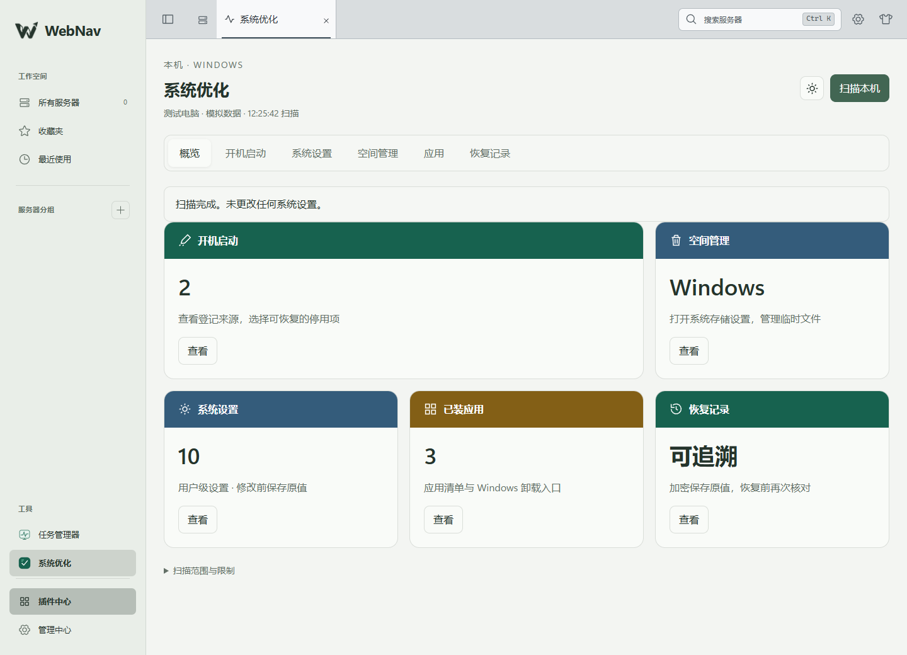
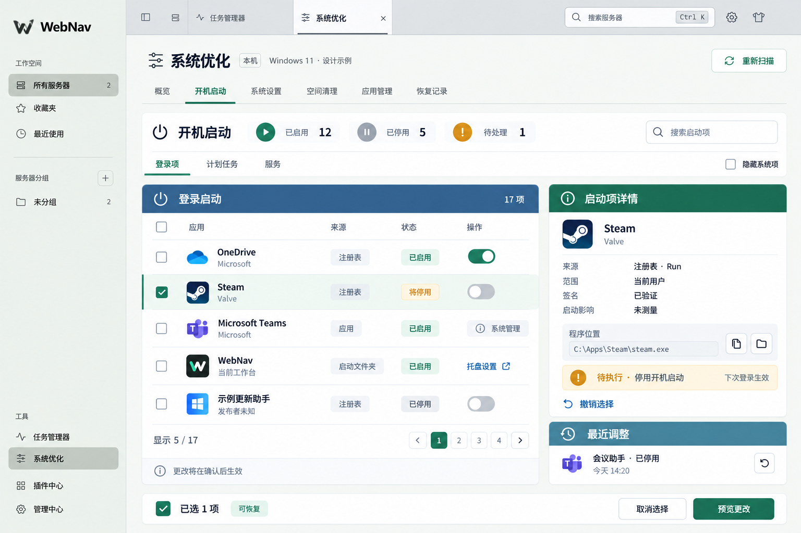

# 系统优化独立插件：实现、方案与验证

2026-10-29：插件 0.1.1 迁入框架管理的独占 Worker，最低宿主 0.1.2，使用 `PluginWorkerApi` 的异步解锁查询和资源租约。模拟 Windows 适配器的随附安装、停用/卸载/恢复、扫描/预览/写入/恢复、锁定、深色及 390px 浏览器回归通过；本批没有执行真实系统写入。线程故障与迁移边界见 [插件 Worker](plugin-workers.md)。下方 2026-10-28 记录保留原首版验收范围。

日期：2026-10-28。状态：官方内置的独立插件首版已实现，源码与可运行产物见 [插件目录](../plugins/system-optimizer/README.md)。需要小站 0.1.1，支持运行后端的本机 Windows 11 x64；随小站提供，首次启动自动安装，无需市场或 Git 操作；此次未重启日常实例。真实环境只验证读取与 DPAPI 测试数据加解密，系统配置写入使用隔离适配器验收。Windows 10、ARM64、Linux、macOS 和远程 SSH 优化另行适配。

## 现在如何测试

1. 源码开发模式：在 `E:\git\webnav` 运行 `pnpm dev`；已有本仓库开发实例时从托盘重启，等待就绪后刷新页面。托盘重启会断开已有连接。生产模式先 `pnpm build`，再从托盘重启。
2. 点击左侧“系统优化”，或“插件中心 → 已安装 → 系统优化（官方 · 内置）→ 打开”，不需要安装 ZIP 或 Git 仓库。
3. 先点击“扫描本机”，检查启动项、10 项设置及应用清单。查看详情和预览不会执行修改；取消预览后系统状态不变。
4. 点插件齿轮 → 字体与外观，调整“系统优化 · 列表与按钮”，检查即时生效；再从插件中心齿轮进入，应看到同一设置。
5. 在已安装卡片停用，工具入口消失但设置仍在；启用后恢复。卸载移出已安装列表，重启也不会装回；“发现插件 → 系统优化 → 恢复安装”可恢复配置和数据。

真实系统写入尚未实机验收，请在测试 Windows 中验证应用和恢复。自动化模拟流程可在仓库运行 `pnpm --filter @webnav/backend exec node --experimental-strip-types tests/system-optimizer-browser.mjs --bundled`，它使用隔离数据，不修改日常电脑设置。

## 当前已实现

| 功能 | 首版交付 | 尚未开放 |
| --- | --- | --- |
| 概览 | 手动扫描、真实数量、扫描时间与覆盖说明，未扫描显示未知 | 健康评分、提速承诺均不提供 |
| 开机启动 | Run/RunOnce、启动文件夹、自动服务、开机/登录任务查询；当前用户 64 位普通 Run 项停用和原值恢复 | StartupApproved、签名与启动影响测量；启动文件夹、服务、任务和本机级登记写入 |
| 系统设置 | 10 项当前用户设置；无默认勾选，预览后应用 | 管理员提权、安全服务、系统更新策略 |
| 应用 | 桌面与当前用户商店应用清单、Windows 应用卸载入口 | 任意卸载命令、批量卸载和残留删除 |
| 空间管理 | Windows 存储设置入口 | 插件直接删除临时文件、清空回收站或估算释放空间 |
| 恢复记录 | DPAPI 加密原值、先保存再写入、逐项读回、冲突停止、预览恢复、持久操作 ID | 强制覆盖其他修改、跨用户解密保证 |
| 框架接入 | 公共 SDK 注册导航、工作区、设置、4 项命名字体；锁定/断线清理临时详情与迟到响应 | 无宿主专用按钮、服务或 RPC 分支 |

10 项规则为：显示文件扩展名、显示普通隐藏文件、资源管理器打开此电脑、减少资源管理器建议、关闭透明效果、减少开始菜单建议、减少 Windows 使用提示、减少更新后的欢迎建议、减少设置中的建议、减少设备设置提醒。精确路径、目标值和文案以 [固定规则](../plugins/system-optimizer/windows/rules.json) 为准；来源及许可证见 [SOURCES](../plugins/system-optimizer/SOURCES.md)。配置写入与界面效果分开：效果可能需要重新登录，插件不自动重启。

[启动项](design/screenshots/system-optimizer-startup-implemented.png) · [更改预览](design/screenshots/system-optimizer-preview-implemented.png) · [系统设置](design/screenshots/system-optimizer-settings-implemented.png) · [深色](design/screenshots/system-optimizer-dark-implemented.png) · [390px](design/screenshots/system-optimizer-mobile-implemented.png)。截图标有“测试电脑 · 模拟数据”，不会注入用户运行目录。

## 独立交付与实施顺序

本文件只管理优化工具的产品范围、系统动作及验收；框架实现由[平台实施记录](plugin-platform-implementation.md)独立管理。现有[概览图](design/system-optimizer-overview.png)、[启动项图](design/system-optimizer-startup.png)与[设计提示](design/system-optimizer-prompts.md)继续作为工具设计参考。

本轮按顺序完成框架的通用页面、设置、字体、插件通信与生命周期验收，再开始本插件业务实现。优化工具通过公共 SDK 贡献工具、设置和字体，以插件自己的命名空间处理扫描、预览、执行与恢复。框架验收使用隔离示例，不执行任何系统优化动作。

下文保留完整产品目标和后续动作约束，不能解释为全部已实现；当前交付以上表和文末验证为准。暂不开放的功能没有使用灰色按钮冒充实现。实际优化写入只用隔离适配器验收，不修改用户日常电脑配置。

提供单独安装、启停和更新的「系统优化」插件，集中管理开机启动、常用设置、空间清理、应用及恢复记录。默认先扫描，用户选择修改并预览影响后执行。首页显示真实数量、空间和状态，不设置缺乏测量依据的健康分数或“提速百分比”。

## 页面接入方式

保留小站现有页面框架。系统优化插件声明并注册自己的工具入口，框架根据注册表在左侧「工具」区域生成按钮，点击后在通用右侧工作区容器展示插件组件。按钮名称、图标和组件属于插件，框架不写死「系统优化」或判断该插件 ID。原左侧的所有服务器、收藏夹、最近使用、服务器分组、插件中心和管理中心继续可用；顶部连接标签、搜索、设置和外观入口继续保留。

插件内部使用横向页签：概览、开机启动、系统设置、空间清理、应用管理、恢复记录。不替换主导航，不增加第二条竖向导航，不增加左下角「返回工作台」。切换原导航或已有标签即可继续原来的工作。重复点击插件入口聚焦已有页面；切换视图不重新挂载或断开 SSH / 桌面连接。

## 开源工具调研与选择

以下结论来自官方仓库、许可证和文档，查询日期为 2026-10-28；具体 Windows 构建下的行为仍需逐项验证。

| 项目 | 许可与状态 | 值得参考的功能 | 本插件采用方式 |
| --- | --- | --- | --- |
| [WinUtil](https://github.com/ChrisTitusTech/winutil) | [MIT](https://github.com/ChrisTitusTech/winutil/blob/main/LICENSE)，仓库未归档 | 软件安装、系统设置、修复、更新设置、分组预设 | 主要规则参考；按单项审阅、固定提交并保留许可信息，不直接执行整套预设 |
| [Win11Debloat](https://github.com/Raphire/Win11Debloat) | MIT，仓库未归档 | 系统推荐、搜索、资源管理器、预装应用管理、设置识别与撤回 | 补充用户级设置规则；不整体搬入去应用或停用安全功能的动作 |
| [BleachBit](https://github.com/bleachbit/bleachbit) | GPL-3.0-or-later，覆盖源码和清理定义 | 清理规则、删除前预览、命令行执行 | 二期评估固定版本的独立清理引擎；后续再实现少量明确的临时文件规则，当前仅提供 Windows 存储入口 |
| [BCUninstaller](https://github.com/BCUninstaller/Bulk-Crap-Uninstaller) | Apache-2.0，仓库未归档；README 同时标有招募维护者 | 批量卸载、应用识别、卸载残留检查 | 应用管理交互与识别逻辑参考；先做清单和系统卸载入口，残留删除后置 |
| [Optimizer](https://github.com/hellzerg/optimizer) | GPL-3.0，已归档；README 明确弃用并指向 OptimizerNXT | 启动项、系统设置、清理、DNS、服务等综合功能 | 功能覆盖对照，不选为新插件核心依赖 |

[Win11Debloat 的 README](https://github.com/Raphire/Win11Debloat/blob/master/README.md)和[发行记录](https://github.com/Raphire/Win11Debloat/releases)说明配置与撤回范围。[BleachBit 命令行文档](https://docs.bleachbit.org/doc/command-line-interface/)提供预览和清理接口，但不能据此假定具备本项目需要的结构化结果、冻结文件清单或完整回滚能力，需独立验证。

其他候选的边界：

- [Winhance 当前许可证](https://github.com/memstechtips/Winhance/blob/main/LICENSE.txt)为 PolyForm Shield 1.0.0，带竞争用途限制；本方案不复用其代码或资源，不当作 MIT/GPL 一类候选直接改造。
- [Microsoft Autoruns](https://learn.microsoft.com/en-us/sysinternals/downloads/autoruns)的启动位置覆盖值得参考，但不属于本方案的开源依赖。[Sysinternals 条款](https://learn.microsoft.com/en-us/sysinternals/license-terms)限制再分发，不随插件捆绑其二进制。
- [OptimizerNXT](https://github.com/hellzerg/optimizerNXT/blob/main/README.md)是原作者后继 CLI 项目，可参考声明式动作和签名配置；其发布包与许可证未在本轮完成审查，不作为依赖。通用 Shell 执行不进入公开能力。

建议自行维护 Vue 界面和动作执行器，以 WinUtil、Win11Debloat 的单项规则及 Windows 官方接口为主要依据。每条复用规则记录来源文件、提交、许可证、适用系统和测试结果。首版不复制 GPL 清理定义；二期若分发 BleachBit 或使用其源码、规则，按实际集成方式履行许可及源码提供要求，不能仅凭“独立进程”推定没有义务。独立插件发布时明确自己的许可证和第三方通知。

## 原产品目标与后续分期（不是当前完成清单）

| 页面 | 原规划 P0 目标 | 后续 P1 / P2 |
| --- | --- | --- |
| 概览 | 扫描时间和覆盖范围、启动项数量、清理空间、设置待办、恢复入口 | 用户保存的设置方案；导入先预览，不自动执行 |
| 开机启动 | 来源、发布者、用户范围、签名、路径、状态；受支持普通 Run / 启动文件夹项的停用和恢复；任务与服务只读查询 | 计划任务启停、服务启动方式、针对受支持来源的延迟启动 |
| 系统设置 | 文件扩展名、隐藏文件、资源管理器打开位置、用户级系统推荐与广告设置、动画效果 | 电源方案、通知、后台权限、隐私选项、更新设置入口；逐系统构建适配 |
| 空间清理 | 当前用户临时文件扫描与清理、回收站容量和独立清空确认；显示跳过和失败项 | 缩略图、应用缓存、BleachBit 适配；浏览器清理按项目明确选择 |
| 应用管理 | 桌面/商店应用清单、发布者、版本、可获取大小；打开系统卸载界面 | 逐项/批量卸载、受控 WinGet 安装更新、残留检查及单独删除预览 |
| 恢复记录 | 设置原值、启动项备份、操作结果、部分失败、恢复预览、状态冲突提示 | 配置方案、选择性恢复、经验证的 Windows 还原点辅助 |
| 高级工具 | 不作为首版可用功能展示 | 服务管理、DNS 查看/切换、缓存刷新、网络诊断、SFC/DISM 修复 |

高级工具放在系统设置的二级入口。开机启动的「服务」页只关注自启属性，与后续服务管理共享数据和动作。已有任务管理器继续负责实时 CPU、内存、GPU 和进程操作，插件通过入口跳转，不重复建设监控仪表盘。

首批设置以约 10–15 个能读回、能保存原值的条目为目标，实际条目按适配与测试结果缩减。初始不选中写入；用户主动选择建议方案后仍需查看逐项变化。减少动画、停用启动项、调整电源都有使用取舍，不能统一宣称能提升性能。

首版不做注册表垃圾扫描、内存强制释放、驱动下载更新、磁盘碎片整理或自创网络加速参数，不把关闭 Defender、UAC、防火墙和安全更新作为推荐。文件粉碎与空闲空间擦除不在清理范围。

## 来源适配的完整目标与约束

来源适配器分别返回覆盖范围、结果和允许动作，不能因一个目录读取成功就宣称全量扫描完成。

| 来源 | 目标查询范围 | 修改边界与后续要求 |
| --- | --- | --- |
| Run | 当前用户和本机范围，处理适用的 32/64 位注册表视图 | 优先支持当前用户普通项；本机项待管理员执行流程验收后启用 |
| RunOnce | 当前用户和本机范围 | 只读，标为单次启动，保留安装/更新收尾语义 |
| 启动文件夹 | 当前用户和公共目录，识别快捷方式目标 | 当前只读；未来停用/恢复须备份原文件与位置，不执行目标 |
| 计划任务 | 开机/登录触发的任务，区分主体、条件和启用状态 | 首版只读，后续通过 Task Scheduler 修改并备份定义 |
| 服务 | 自动及延迟自动服务、运行状态、依赖 | 首版只读，运行状态与启动方式分别显示 |
| 应用启动任务 | 能力允许枚举的已打包应用信息 | 未支持的来源明确标为未覆盖，提供系统设置入口 |

Windows 文档区分了 [Run / RunOnce](https://learn.microsoft.com/en-us/windows/win32/setupapi/run-and-runonce-registry-keys)、[开机触发](https://learn.microsoft.com/en-us/windows/win32/taskschd/boot-trigger-example--scripting-)和[登录触发任务](https://learn.microsoft.com/en-us/windows/win32/taskschd/logon-trigger-example--scripting-)。注册项存在不等于有效启用、已经运行或导致启动缓慢。

身份绑定机器、用户 SID、来源类型、注册表视图/任务路径/文件位置及项目名。同名程序来自不同位置时保留独立条目。执行前核对版本指纹；签名状态分已验证、未签名、校验失败和未知，不由发布者名称推断可信，默认不向云端上传文件或哈希。

Run 项备份键名、类型、原始值和注册表视图；启动文件夹条目保存原文件和元数据，跨卷时先复制、校验，再移除源项。恢复前发现原位置有新内容则提示冲突，不覆盖。对 Windows 自身禁用状态使用已验证适配，不能凭未经验证的 StartupApproved 二进制格式硬写；无法判定时显示「已登记 / 状态未知」，不计入已启用数量。

小站自身自启只读，提示在已有托盘设置中管理，避免与 supervisor 各自修改同一项。微软签名不等于可以批量关闭，未知发布者也不等于恶意软件。启动影响没有有效采样时显示「未测量」，不能用实时 CPU 或软件知名度猜测高低；首版不承诺开机耗时测量。

主列表只显示图标、名称、发布者、来源、状态和操作。右侧详情按需展示路径、参数、签名和恢复信息。受系统管理或尚不支持修改的项目显示只读状态，不画可点击开关。

## 修改预览与恢复

统一流程：扫描 → 选择更改 → 预览前后值和影响 → 保存恢复材料 → 必要时请求 Windows 管理员授权 → 执行 → 读回核对 → 保存结果。

开关仅编辑待执行清单，行内显示「将停用 / 将启用 / 待修改」；「预览更改」打开确认抽屉，呈现项目、当前值、目标值、管理员要求、恢复级别和生效时机。最终按钮用「应用 3 项更改」等具体名称。

| 类型 | 页面标记 | 恢复语义 |
| --- | --- | --- |
| 普通设置、受支持启动项 | 可恢复 | 保存精确原值，包括原值不存在；恢复前检查当前值仍是本插件最后写入值 |
| 后续任务、服务、DNS 动作 | 条件恢复 | 保存定义和原状态，系统已变化时重新预览 |
| 文件删除、回收站清空、软件卸载 | 不可撤销 | 单独选择和确认，不能显示可恢复；还原点不能代替文件备份 |
| 需注销/重启的设置 | 待注销 / 待重启 | 区分配置写入与真正生效，只提供用户主动操作入口 |

跨注册表、文件、服务的操作不具备数据库式原子事务。每项执行前持久记录原值和预期值，执行后读回；失败显示已完成、失败、未执行及待核对项目。崩溃或超时后先核对，不能自动重放。恢复也是新的预览和操作，不能拿整份旧配置覆盖用户之后的修改。

还原点作为后续附加能力，创建失败须明确显示；普通可恢复设置始终依靠自身原值备份。清理仅处理受控目录和规则，排除文档、下载、仓库、小站数据、历史、凭据和活跃传输文件；跳过占用文件与符号链接、junction/reparse point。删除前核对最终目标、文件身份及版本，阻止预览后的路径替换。预览空间为估算，执行后另报实际释放与跳过量。

## 独立插件的技术接入

### 安装与宿主入口

独立仓库包含清单、已构建前后端、规则、Windows 助手、图标、说明和第三方通知。插件 ID 为 `webnav.system-optimizer`，不使用 `builtin.*`。主分类使用现有 `productivity`，次分类 `monitoring`、`backup`，不新增市场分类。清单仅声明实际交付验收的平台，基础功能不要求用户手工装优化软件或脚本模块。

安装不调整系统、不添加自启、不请求管理员权限。普通读取以当前用户运行；需要提权时启动短时助手，小站宿主仍使用普通权限。助手随包固定版本与 hash；后续可选组件也按固定来源、版本和 SHA-256 下载缓存，不使用在线脚本管道执行。

[共享插件契约](../shared/src/plugins.ts)、[前端加载器](../frontend/src/plugins.ts)、[后端运行时](../backend/src/plugin-system/runtime.ts)和 [App 工作区](../frontend/src/App.vue)已支持通用 `registerTool`。独立插件注册自身工具，不修改主导航、主组件、服务白名单或固定视图槽位。`registerView` 保留为旧能力替换接口。

具体契约见 [公共 SDK](plugin-sdk.md)。插件沿用可扩展的 `extension:system-optimizer@1` 能力标识，在清单 `contributes.tools` 声明入口，在前端 `activate(api)` 中调用 `api.registerTool('main', { component: OptimizerPage })`。宿主只认识通用工具定义，校验声明、活动插件和注册组件后动态显示入口；不再新增系统优化专属服务能力或固定槽位。这些字段和 API 已在宿主 0.1.1 实现，并由两个独立示例和本插件完成隔离安装验收。

框架只管理工具声明与注册、导航呈现、通用工作区标签和生命周期。系统优化的规则、DTO、校验、读取、写入、恢复和私有后端模块留在插件，使用已有插件命名空间 RPC 和资源租约；`shared/` 只新增通用工具契约。前端复用宿主 Vue，样式限定插件根节点，不能直接向宿主 DOM 插按钮。已有替换型服务继续使用原契约，不要求所有插件都成为宿主服务提供者。

最低宿主版本填写实际提供通用注册能力的发行版本。安装启用且前端激活成功后出现入口，停用/卸载在任务安全收尾后自动移除；热更新失败保留旧入口和旧页面并显示原因。工具以插件 ID 和局部工具 ID 组成稳定身份，重复点击聚焦原标签，切换不卸载现有终端，关闭工具标签只关闭该页。

### 服务与权限

当前插件 RPC 为 `scan/details/preview/apply/job/history/restorePreview/openSettings`。扫描、预览、应用和历史通过有界后台任务与查询返回；独立取消及事件订阅仍待实现。这些方法不成为宿主固定服务契约。公开 RPC 使用 `plugin.<插件ID>.<方法>`，全部走已有鉴权业务 WS；不增加 REST 业务接口或远端端口。

浏览器只提交条目/规则 ID 和经校验的参数，不提交任意命令、注册表路径或删除路径。计划绑定机器、用户、规则版本、扫描版本、当前状态、期望状态、权限、恢复级别和期限；建议有效期 5 分钟，执行前重查前置条件，过期或变化必须重新预览。

写入使用持久操作 ID：同 ID 同计划返回同一任务，同 ID 不同内容拒绝。宿主去重之外，插件保存跨重启账本；结果未知先查询任务并读回系统，不重送。当前任务按 ID 查询，不广播完整参数和备份；若以后增加订阅，只推送带版本的任务摘要，重连重新同步。来源读取失败或未扫描时显示未知与覆盖不足，不能显示 0 项或全部健康。

普通助手通过有界 stdio 通信。管理员助手尚未实现；后续应使用仅授权 SID 可访问的本机 IPC，核对父进程、用户、随机凭据、计划摘要、过期与重放状态。不同管理员账户完成授权时仍绑定原目标用户 SID，不得误改管理员 HKCU。固定程序与参数数组启动，仅接受编译进助手的白名单动作，不开放本机 HTTP 管理服务。

首版使用随插件固定的 PowerShell 助手和规则文件，启动前联合 SHA-256 校验，请求通过结构化 stdin 交接，不拼接用户命令。Go 原生适配、签名和直接文件操作仍属后续范围。此协议不能被描述成对恶意第三方插件的权限隔离。

### 生命周期与记录

扫描、写入、恢复、下载和助手持有资源租约。更新/停用先停止新任务，等待安全边界和结果核对后切换；不能为热更新强杀提交中的系统操作。回收失败保留记录并显示待重启原因，其他独立插件继续运行。

当前扫描由助手超时和任务完成收尾，尚无独立取消按钮；未来取消已开始的系统调用也须在安全边界停止。页面关闭或 WS 断开后已提交任务由后端收尾并持久记录，未提交选择失效；重新打开查询原任务，不重放。锁定拒绝新动作，完成当前不可中断步骤的核对后停止后续项。退出通过宿主维护流程等待安全收尾。

数据放入 `api.dataDirectory`；账本和恢复材料限制当前用户访问。参数和原值可能含敏感信息，完整备份使用系统用户保护的加密存储，摘要脱敏，不进入日志、目录备份、浏览器持久化或配置同步。卸载不自动反向修改系统；提供卸载前恢复入口并保留未恢复材料，删除恢复材料单独确认。

首版限额：同一时间一项长任务，选择最多 50 项，预览有效 5 分钟。扫描返回有界快照最多 10,000 项，来源另有 1,000/2,000 项上限并提示可能不完整；前端每页展示 50 项，尚未实现服务端分批扫描。助手输入 2 MiB、输出 4 MiB，默认 30 秒超时；调用关闭前持有资源租约。恢复记录最多 1,000 次、总量 100 MiB、单文件 2 MiB，达到限额拒绝新增备份，不自动淘汰；按 20 条分页按需解密，缓存最多 40 条。这些是实现限额，不是容量或性能保证。

首版不声明 AI 写入能力；后续接入须遵守现有 MCP 声明、handler、提供者及授权同时有效的规则，不公开任意系统执行能力。

## 原始 UI 概念设计

### 总览布局

左侧和顶部沿用真实小站截图的结构，图中的「系统优化」按钮和工作区标签是插件注册后由框架统一渲染的结果，不是框架专用按钮。右侧上方是插件自己的标题、本机标记和扫描按钮，其下为横向功能页签。第一行用较大的启动项卡片配空间清理卡片，第二行是系统设置、应用管理、恢复记录。底部操作条只占右侧内容区。首次未扫描显示「开始扫描」，不填示例数字。

### 开机启动布局

右侧保留同一标题和横向功能页签。数量、搜索和来源筛选放在上方，左边约三分之二宽度显示条目，右边显示选中项详情和最近调整。大量条目使用紧凑、对齐的列表卡片，不把每条记录做成大块磁贴。修改以「将停用」等状态区分于已生效值。

### 色彩与适配

| 元素 | 浅色示例 | 深色示例 | 约束 |
| --- | --- | --- | --- |
| 宿主导航、顶部、页面底色 | 继承当前主题 | 继承当前主题 | 插件不得全局覆盖 |
| 卡片正文 | `#FFFFFF` | `#1B2927` | 比页面背景更明确的阅读区域 |
| 启动/恢复标题栏 | `#17624F`，白字 | `#294E43`，浅字 | 整条标题背景与正文区分 |
| 设置/清理标题栏 | `#345C7B`，白字 | `#263E52`，浅字 | 保留完整色带，不能只改标题文字颜色 |
| 应用标题栏 | `#835F16`，白字 | `#544122`，浅字 | 暖色辅助，警告另有图标和文字 |
| 主操作 | `#16735D` | `#75CFB7` | 扫描、预览、确认 |

用语义化 CSS 变量，作用域限定插件内容。标题栏约 48–56 px，圆角 12–14 px，卡片间距 16–20 px。正文以图标、数字、短标签为主；长解释按需展开，状态不只靠颜色。按钮提供可访问名称与悬停提示。普通文字对比度验收目标至少 4.5:1，大字及控件至少 3:1，实现时逐对检查。

断点按右侧实际可用宽度计算，不按整窗宽度硬编码；约 1100 px 以上采用图示组合，720–1099 px 两列卡片，低于 720 px 单列并把详情改为抽屉。横向页签在窄屏可滚动，主导航继续使用宿主既有折叠行为。390 px、深色、键盘焦点、断线、无结果、权限不足、部分扫描及恢复冲突必须验证。

两图使用内置 imagegen 生成，数字、应用、路径和时间均为设计示例；来源标签也不代表对某个实际安装的探测结论。图中总体数量是布局数据，不进入真实运行页面。当前首版浅色、真实夜航主题和 390px 已通过浏览器验收，实际布局见本文开头截图；概念图中的文件清理和空间数字不是当前功能。完整提示词见 [设计提示词](design/system-optimizer-prompts.md)。

## 实施与验收

1. **通用工具注册与只读扫描**：先完成声明校验、注册表、动态导航、通用工作区和生命周期；用两个不同的隔离示例插件验证不修改宿主也能注册/注销入口。再由独立系统优化插件接入扫描，验证安装/启停/热更新、助手通信和来源覆盖，已有终端不重建。
2. **可恢复写入**：完成普通启动项和首批设置、预览、原值备份、账本、UAC、读回和冲突恢复；覆盖取消授权、跨用户、过期计划、权限不足及外部修改。
3. **清理与应用清单**：验证链接跳转、文件替换、占用、容量限额、部分失败和不可撤销提示；首版卸载交给系统界面。
4. **扩展工具**：按需求逐项增加任务写入、服务、网络、固定版本清理引擎和批量应用操作，分别记录构建及实机范围。

自动测试使用隔离注册表测试键、测试目录、专用计划任务/服务和虚拟助手。真实登录、UAC、注销及重启在一次性 Windows 测试用户或虚拟机中验收，不能改变当前日常系统作为测试。必须覆盖重复操作 ID、未知结果、原值不存在、恢复冲突、助手提前退出和正在写入时请求卸载。

### 2026-10-28 实际结果

- 已先完成框架门槛，随后完成独立插件源代码、运行产物、规则、图标、MIT 许可及来源说明。未复制或执行整套第三方优化脚本，后续已接入官方随附目录，随更新后的工作台启动自动提供，无需发布到市场。
- 插件严格 TypeScript 检查与构建通过。`backend/tests/system-optimizer.test.mjs` 5 项通过：只读快照、原值/身份核对、写前加密备份、重复操作与重启恢复、锁定停止、外部冲突、备份失败无写入、结果未知不重放、异常扫描响应拒绝。
- `backend/tests/system-optimizer-browser.mjs` 通过独立 Git 安装、手动扫描、选择/预览/应用/恢复、字体生效、浅深色与 390px，以及锁定清除详情和解锁重新扫描。Windows 动作由临时仓库中的模拟适配器处理，不修改发布目录的原生适配器。
- 本机 Windows 11 build 26200 x64 实际只读扫描获得 10 项设置、166 条启动登记及 470 条应用记录；数量仅对应当时本机可访问范围。Windows PowerShell 解析检查与 DPAPI 测试文本加解密通过。没有执行真实注册表设置写入、注销、重启或文件清理。
- 原生写入、重启后系统效果、管理员流程及其他 Windows 构建兼容性尚未实机验收；临时文件清理、启动文件夹写入、任务/服务修改属于后续范围。

官方随附追加验证（2026-10-28）：2 项随附包单元覆盖自动安装、禁用与配置随升级保留、卸载重启保持、恢复安装、无效包隔离及缓存校验。`system-optimizer-browser.mjs --bundled` 验证官方内置标记、无需 Git 安装、禁用/卸载跨重启、发现页恢复及配置保留，并继续执行扫描、预览、模拟应用/恢复、字体、浅深色、390px 和锁定清理。
