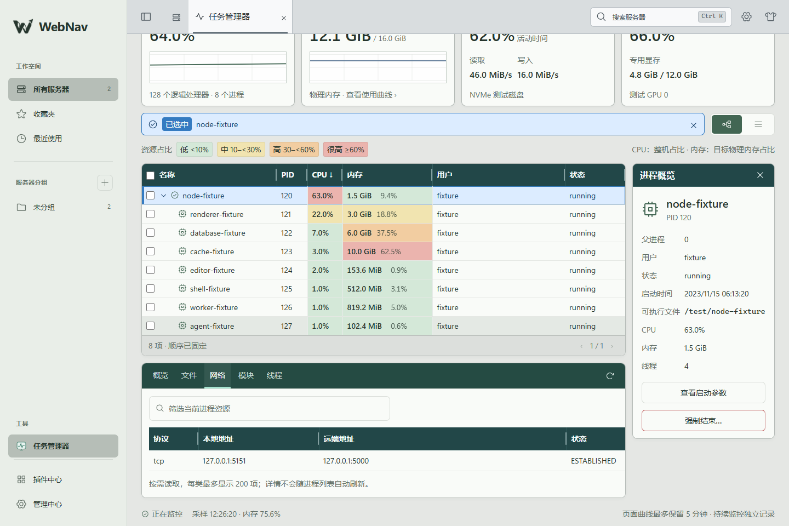
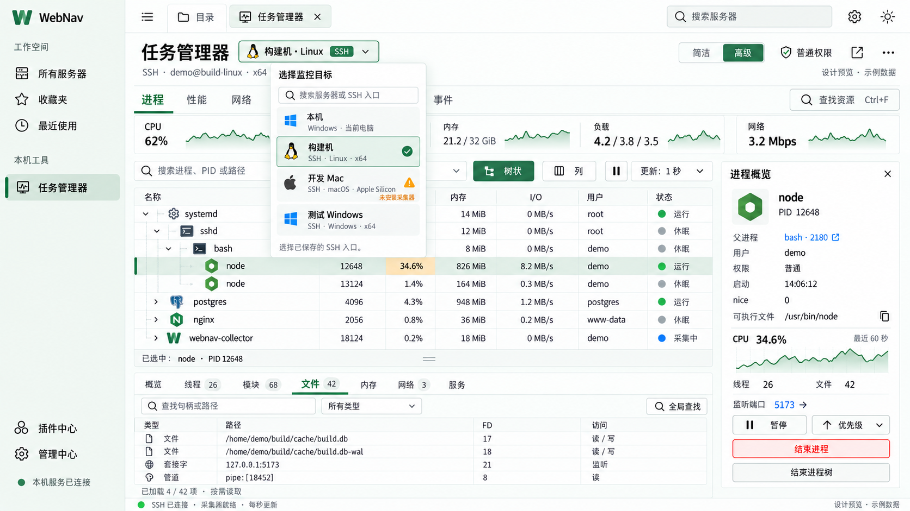
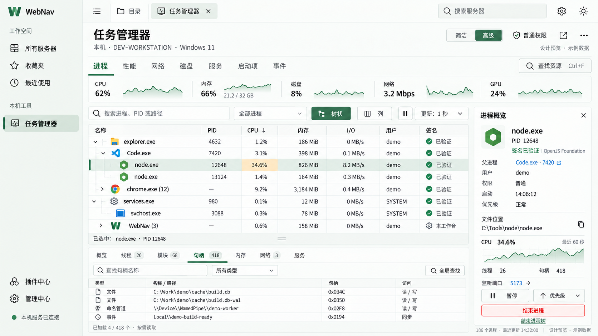
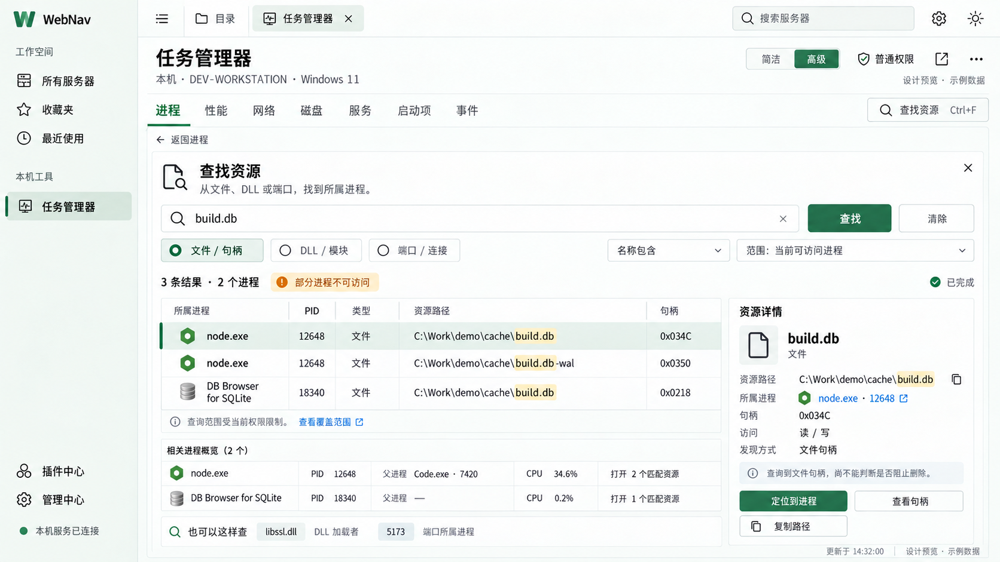
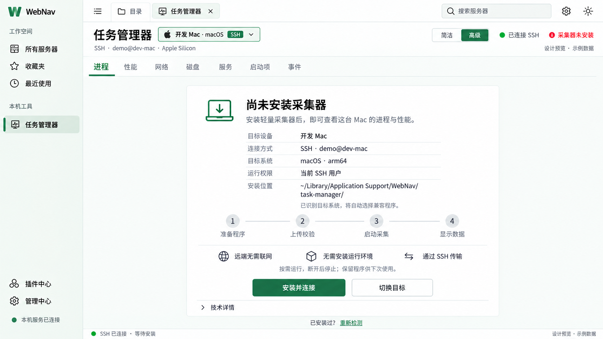

# 跨平台任务管理器插件

0.4.0（2026-10-29）：声明独占 Worker，采集与 SSH 业务仅在该线程运行；与系统优化使用不同线程。宿主访问改为异步，连接预算在协调端原子预留，指纹与写入去重在等待后重新核对。详见 [插件 Worker](plugin-workers.md)。

2026-10-28。任务管理器面向 Windows、Linux、macOS，管理运行小站后端的本机，或任意已保存且可访问的 SSH 入口。参考 Process Hacker / System Informer、Process Explorer 等工具，覆盖日常任务管理和进程诊断。远端没有采集器时提示「安装并连接」，用户点击后自动完成程序准备、上传、校验与启动。

已实现工作区、插件契约、原生采集器及本机/SSH 安装流程；0.2 版本增加性能视图、逐逻辑处理器、磁盘与 GPU 采集，以及进程占用热度。0.3 扩展为可选的目标独立持续记录与历史回溯，0.3.1 增加多进程观察与按需读取启动参数。本文先记录当前实现，再保留高级能力设计；实际验证批次单独列出。概念图中的主机、进程与曲线均为示例，不能作为平台验收或功能已实现的证据。

## 当前实现与运行

- 进程右键菜单 `builtin.taskManager/process` 和详情标签区 `builtin.taskManager/process-details` 已采用 [通用界面扩展 SDK](plugin-ui-extensions.md)。其他插件可声明菜单和详情组件，通过 `find/activate` 定位当前实例；上下文包含 monitorId、bootId、目标入口、PID 与创建时间，切换目标或进程会失效旧实例。静态用途与字段表见 [目录](plugin-ui-catalog.md)。仅实现扩展机制与诊断示例，真实调试器仍由独立插件实现。

- 左侧「工具 → 任务管理器」打开独立工作区标签，可选运行后端的本机或目录中任意已保存 SSH 入口。切换目标关闭旧查看连接；显式开启的持续记录仍在原目标运行，同一页面的其他终端保持原实例。
- 缺少兼容采集器时点击「安装并连接」，显示安装位置与阶段。Windows、Linux、macOS 均使用当前目标用户目录下的 `.webnav/tools/task-manager/0.3.1/<platform>-<arch>/`。例如 Windows 为 `%USERPROFILE%\.webnav\tools\task-manager`，Linux/macOS 为 `$HOME/.webnav/tools/task-manager`。不使用应用数据目录替代用户指定的位置；更新采用版本目录，旧版本文件保留，不覆盖正在运行的程序。历史放在同级的 `recording-v1`，不跟随程序版本清空。
- 进程列表/树、搜索、排序、分页与按需详情；「进程 / 性能」视图切换。进程页提供 CPU、内存、磁盘和 GPU 紧凑概览；性能页可以选 CPU 整体/逻辑处理器、内存、磁盘或 GPU，并切换具体设备。
- 点击进程后使用持续的蓝色选中行，与浅色悬停区分；输入框显示名称和「已选中」，不把该名称当成筛选。选中期间固定当前列表顺序与层级，数值继续刷新；未采集到的其他行保留位置并标为未知，新增行在取消选中或显式重排后显示。主动输入切换成筛选；×、输入框 Escape、详情关闭和菜单「取消选中」清除选择与筛选。所选进程退出/不可访问、PID 复用或切换目标时清除旧选中，不能继承到另一个进程。
- 进程行右键或 Shift+F10 打开应用菜单，提供详情、网络连接、文件/句柄、复制名称/PID/路径、在线搜索和按能力显示的结束操作；在线搜索仅在点击后把进程名称发送到搜索网站。结束操作仍经过原有计划、身份核对与确认，菜单绑定监控 ID 和进程启动身份；切换视图、目标、锁定或连接清理时关闭。
- 进程表默认名称 246px、PID 56px、CPU 64px；名称按原截图约缩小 40%，PID/CPU 约减半，不再被剩余空间平均撑宽。进程、诊断、历史进程及历史磁盘表均可拖动各列表头右边界；双击恢复该列，方向键微调（Shift 加速），Home 恢复，Escape 取消当前拖动。仅列宽作为浏览器外观偏好保存，刷新、排序、切换详情或重新打开仍保留；窄屏在表内横向滚动，不改变采集连接。
- 页面标题、资源卡片标题、表头、右侧概览、下方详情和历史/性能标题统一采用高反差色带，卡片正文与页面底色分离，卡片之间保留间距；浅色/深色主题均适配。CPU 与内存单元格采用绿、黄、橙、红四档热度：低于 10%、10–不足 30%、30–不足 60%、60% 及以上。CPU 按整机占比，内存按目标物理总内存占比，保留数值与图例，不使用列表最高值作为分母。
- 整机曲线最多 300 点/5 分钟；逐核每页最多 64 核，仅保存当前页各 120 点，换页清除离页核心历史。设备曲线使用各自实际采样时间，同一缓存样本不重复追加。首次采样、计数器重置、驱动或权限不足显示未知及原因，不显示假 0%。
- 性能与历史图采用任务管理器式细蓝线、浅蓝面积填充、淡色密网格与时间刻度，深色主题使用对应配色。面积按每段连续采样单独闭合，历史缺口保持空白，保留原始峰值与比例，不通过平滑改写采样值。
- 结束进程采用 30 秒有效计划，确认目标、进程名、PID、创建时间和结束方式后执行。Linux 提供常规退出和显式强制结束，Windows 首版仅提供显式强制结束；macOS 首版只读，不开放结束动作。不因超时升级操作。保护采集器、祖先进程链与 PID ≤ 4，Windows 另检查关键进程标志和保护名单，执行时重新验证创建身份；不承诺识别所有 Linux 关键守护进程。
- 采集器使用 Go 与固定版本依赖，目标不需要 Node.js、Python 或联网。通过本机 stdio 或独立 SSH exec 的 stdio 交换有界 JSON 行，不监听服务端口，不申请交互 PTY，不记录进终端历史。
- Windows SSH 启动器直接用标准输入句柄的 `FileStream` 转发原始字节，保留每次写入后的刷新和 EOF 收尾。Windows PowerShell 的 `ConsoleStream` 对 OpenSSH 的 OVERLAPPED 输入管道可能在首次握手后阻塞，不能通过增加采集超时解决；其他平台仍直接 exec 原生采集器。
- 原生程序由小站配套分发，选择固定版本清单并校验 SHA-256。源码首次使用先运行 `pnpm collector:build`；正式版构建自动准备采集器。目标缺包时从后端上传，目标无需下载。构建产物位于忽略目录 `backend/native/task-manager/package/`。
- 支持 `service:taskManager@1`、`task-manager` 前端槽位与内置 `builtin.taskManager` 元数据。活动采集、安装及清理阻止提供者替换，结束后自动生效；等待期间拒绝新监控。整包更新也计入活动任务。
- 「持续监控」由用户显式开启：目标独立保存历史，关闭页面、锁定小站、退出小站或断开 SSH 只释放查看连接。再次连接可以回溯；明确关闭持续监控才停止记录，历史仍保留。

首版详情能力：

| 系统 | 进程、CPU、内存 | 进程详情 | 进程控制 |
| --- | --- | --- | --- |
| Windows | 实际可读的进程资料 | 模块、线程 ID；文件句柄暂不可用，网络按接口返回 | 强制结束，持有进程句柄复核身份 |
| Linux | /proc 与系统统计 | 文件、模块、线程、网络，按权限限制 | 常规/强制；需要可用的 pidfd，不能获取稳定引用时拒绝 |
| macOS | 平台适配器统计 | 网络按可用接口返回；文件、模块、线程暂不可用 | 首版只读；未验证可绑定稳定进程身份的控制方式前不开放结束动作 |

平台适配和交叉构建不等于六种环境均已实机验收。实际执行的检查与限制记录在本文末尾。未实现系统快捷键接管、Windows 注册表替换、全局资源搜索、逐进程 I/O、事件追踪、符号栈、服务/启动项、暂停恢复、优先级、进程树批量结束及独立悬浮窗口。

以下是实际 Vue 界面的隔离浏览器验收截图；主机和进程数据来自测试夹具，不是用户机器资料：

[逐逻辑处理器](design/screenshots/task-manager-cpu-logical-light.png) · [磁盘性能](design/screenshots/task-manager-disk-dark.png) · [GPU 性能](design/screenshots/task-manager-gpu-dark.png) · [深色进程页](design/screenshots/task-manager-processes-dark.png) · [安装提示](design/screenshots/task-manager-install-implemented.png) · [390px 性能页](design/screenshots/task-manager-performance-mobile.png)

开发构建需要 Go 1.26 或更高版本，可用 `WEBNAV_GO` 指定编译器。`pnpm collector:build` 生成六个平台/架构二进制与第三方许可证，`node scripts/task-manager-build.mjs --verify` 只读核验清单与哈希，`--test` 运行本机原生测试。此轮产物使用 Go 1.27.3；目标运行基线为 Windows 10/Server 2016、macOS 13、Linux 3.2，Linux 结束操作另要求可用的 pidfd（内核 5.3 起）。基线来自编译器要求，不代表这些最低版本均已实机验证；详见[采集器构建说明](../backend/native/task-manager/README.md)。正式版发行构建会再次验证全部产物，缺失或损坏时不出包。

## 多进程观察与启动参数（0.3.1）

进程名称前提供复选框；表头复选框只勾选当前页可识别的进程，部分勾选时显示中间状态。勾选与蓝色单行选中各自独立：勾选用于观察或批量操作，点击名称用于查看详情。最多勾选 200 项，取消勾选、清空勾选和目标切换会移除相应观察数据；断线、锁定及监控释放清理本次选择。

勾选后点击「只看勾选进程」，表格按勾选顺序固定显示，并展示各进程的 CPU、内存曲线及相对于勾选时的内存增量。曲线跟随已有采样，每个指标最多 300 点、最近 5 分钟；卡片每页最多 12 项。进程退出、采样缺失或 PID 被复用时，旧观察项保留名称、标记不可用并断开曲线，不替换成新进程，也不补成 0。点击「显示全部进程」返回完整列表，保留勾选和本次观察；「清空勾选」同时退出观察模式。观察数据只在本页内存，不改变持续记录的留存策略。

操作栏支持复制 PID、复制进程清单、清空勾选和按平台能力结束勾选项。结束每次最多 16 个当前存在的进程，先为各进程准备原有确认计划，再在同一对话框列出名称与 PID；明确确认后依次执行。准备失败的项不执行；执行失败或结果未知时停止后续操作，不自动重试、不扩展为结束进程树。Windows 为显式强制结束，Linux 默认常规结束，macOS 仍只读。

点击进程后，「概览 → 启动参数」按需读取该进程的完整命令行，支持手动刷新与复制。不会随每次快照重复读取；切换进程、目标、取消选择或锁定后清理，迟到响应不能覆盖新选择。空命令行、权限不足、系统不可读和请求失败分别提示。采集器只返回最多 32 KiB 的 UTF-8 文本，超长明确标记截断；命令行是诊断显示值，不用于重启或执行程序。

| 平台 | 参数读取方式 | 当前验收边界 |
| --- | --- | --- |
| Windows | 固定进程查询 API `NtQueryInformationProcess / ProcessCommandLineInformation`，使用有限查询权限的进程句柄，有界缓冲区 | Windows x64 实际测试子进程经已鉴权 WS 验证；受保护进程可能不可读，不自动提权 |
| Linux | 有界读取 `/proc/<PID>/cmdline`，保留参数边界的显示引号 | 六目标构建中的 Linux x64/arm64 已编译；SSH 协议使用本机模拟，新增读取未实机验收 |
| macOS | 固定 `/bin/ps -ww -p <PID> -o command=`，3 秒预算、有界输出与子进程回收 | macOS x64/arm64 已编译；这是系统展示的命令行，新增读取未实机验收 |

三平台均在读取前后复核 PID 与创建时间。命令行通过独立 `taskManager.commandLine` 只读 RPC 返回，不加入进程快照、历史、日志、导出、同步、浏览器持久化或公开插件扩展上下文；不读取环境变量。旧采集器或替换提供者未实现时明确提示不支持。升级后重新连接，按提示安装配套 0.3.1 采集器。

实际界面截图使用隔离测试进程与曲线：[浅色观察](design/screenshots/task-manager-watch-light.png)、[启动参数](design/screenshots/task-manager-command-line.png)、[深色观察](design/screenshots/task-manager-watch-dark.png)、[390px](design/screenshots/task-manager-watch-mobile.png)。

2026-10-28 本批验证：共享构建、前后端类型检查及生产构建通过；13 项前端任务管理器/历史/观察测试、16 项后端任务管理器测试及本机 Go 原生测试通过。六平台/架构的 0.3.1 产物构建与 SHA-256 验证通过。隔离 Edge 的新增多选观察、既有单选菜单和列宽三组检查通过，覆盖复制、内存增量、真实零值、PID 复用、启动参数权限与迟到响应、批量取消/确认/失败停止、浅深色及 390px。Windows 实测使用专用测试子进程与隔离用户目录，没有重启日常实例；本批未连接真实远端。

## 性能指标与显卡适配

逐逻辑处理器使用各自系统时间计数，Windows 查询全部处理器组；Linux 不重复累计 guest 时间，Windows 不重复累计中断时间。首样本或拓扑改变重新建立基线，缺少的核心明确标记部分覆盖。

磁盘使用真实设备累计读写字节的时间差。Windows 枚举 PhysicalDrive，并用空闲计数计算活动时间；Linux 使用 sysfs 块设备统计；macOS 使用 IOKit 读写字节，但没有可靠的活动时间时保持未知。物理设备容量不等于某个分区的容量，不推断文件系统已用空间，也不把各物理/虚拟设备吞吐相加。

显卡适配覆盖 Intel 独显/集显、NVIDIA、AMD。设备按 LUID、PCI/UUID 或 IORegistry ID 识别，同型号保留独立条目并显示短标识；Windows 的显示适配器条目不直接等于物理显卡数量。

| 平台 / 驱动 | 数据来源与统计口径 | 必要条件与边界 |
| --- | --- | --- |
| Windows Intel / NVIDIA / AMD | WDDM 的 PDH 引擎统计、DXGI 设备和容量；同一引擎累计进程占用，再取最繁忙引擎 | 需要驱动暴露 GPU 性能计数器；首次查询只有容量，下一采样周期才有利用率。专用显存包含 DXGI 的本地显存和 GPU 专用预留系统内存，共享系统内存另列 |
| Windows NVIDIA 计算模式 | 驱动自带的固定位置 nvidia-smi，只补充明确报告计算模式的设备 | 按 UUID 识别，不重复添加 WDDM 设备，不通过相同型号猜测关联 |
| Linux Intel i915 / xe | `/proc` DRM fdinfo 的引擎时间/周期差；去重设备与 DRM 客户端；DRM 只读设备内存查询 | 显示「可访问进程统计 · 覆盖不完整」，不冒充整卡利用率；无客户端不等于 0%。独显总容量来自驱动，已用量需要驱动允许读取；集显不把全部主机 RAM 当作显存上限 |
| Linux AMD amdgpu | 驱动 sysfs 的 gpu_busy_percent、mem_info_vram_used/total | GPU 专用本地显存或预留内存与共享系统内存区分；驱动未提供的指标保持未知 |
| Linux NVIDIA | 已安装驱动的固定路径 nvidia-smi，按 UUID/PCI 识别，MiB 换算字节 | 驱动工具缺失时仍保留已识别设备并显示原因；不以缺少工具表示没有显卡，不静默安装/替换显卡驱动 |
| macOS Intel / AMD / 可用 NVIDIA 驱动 | 固定 ioreg 查询 IOAccelerator 的已知 PerformanceStatistics 字段；设备名称/容量只按精确 PCI 祖先 ID 关联 | 使用明确字段单位，拒绝无效统计；Intel 集显不把预留/窗口大小当成物理显存。旧 NVIDIA 字段解析不表示当前 macOS 版本有官方兼容驱动；Apple Silicon 本轮不在要求范围 |

GPU 专用显存与共享系统内存分开呈现，不相加；共享上限不是额外 RAM。仅有已用字节而没有可靠上限时仍显示字节，不绘制猜测的占比。温度只在驱动返回可验证数值时显示。Linux 按进程统计不累计可能共享的显存页来冒充全设备已用量。

GPU 驱动查询只有一个后台工作者，超时不会不断新建线程或堆积请求。缓存保留设备原时间戳，超过 10 秒清空动态数值；驱动工具进程有独立的关闭回收责任。真实硬件验收与解析器测试分别记录，不能承诺在缺失驱动或系统拒绝权限时仍有真实数值。

指标依据：[Windows GPU 统计口径](https://devblogs.microsoft.com/directx/gpus-in-the-task-manager/)、[DXGI 容量定义](https://learn.microsoft.com/en-us/windows/win32/api/dxgi/ns-dxgi-dxgi_adapter_desc)、[NVIDIA 查询文档](https://docs.nvidia.com/deploy/nvidia-smi/index.html)、[Linux DRM 统计](https://docs.kernel.org/gpu/drm-usage-stats.html)、[AMD 内核统计](https://docs.kernel.org/gpu/amdgpu/driver-misc.html)、[Apple ioreg 实现](https://github.com/apple-oss-distributions/IOKitTools/blob/main/ioreg.tproj/ioreg.c)。

## 持续监控与历史回溯

持续记录与即时查看分开管理，默认关闭。开启后，目标用户自己的后台记录器独立运行，不保存 SSH 凭据、不依赖小站保持连接、不开放网络端口。采样默认每 5 秒，可选 1/2/5/10 秒；历史默认最多 7 天，可选 1/7/30 天。默认容量 256 MiB，可调 64–1024 MiB，时间或容量先到上限就清理最旧记录，因此页面显示实际可查询的起止时间。

记录包括整机 CPU/内存、逐核及磁盘/GPU 的实际性能数据、进程数量，以及当时按 CPU 和内存选出的高占用进程（合并去重最多 40 个）。历史保留目标启动标识、PID 和进程创建时间，进程退出后仍能查看原记录；不保存进程命令行、环境变量或内存正文。历史进程只能查看，不能用旧记录直接结束现在复用相同 PID 的进程。

记录器在 `.webnav/tools/task-manager/recording-v1` 写入受限访问的分段压缩记录和索引，配置与运行状态分开。开启设置不等于记录器已正常运行：启动中、运行、停止、错误、最后采样时间及间断都以目标实际状态为准。并发修改使用版本号，副作用使用持久操作 ID 核对，超时不自动重发。

「历史」页固定所选时间范围，手动刷新才纳入新记录。一次最多展示 300 个真实代表采样点，尽量保留 CPU、内存、磁盘、GPU 峰值；点击时间点再读取完整记录。「该时刻硬件详情」默认收起，展开可查逐核占用（每页最多 64 核）、各磁盘和各 GPU 的原始采样指标、专用/共享内存及统计范围，不重新采集。概览磁盘优先选活动时间最高的单个设备，再比较吞吐，GPU 选最高可读利用率，不能冒充所有设备吞吐之和。记录缺失、裁剪、时钟回退或采集失败明确显示，不在缺口内插补平滑曲线。

[浅色历史页](design/screenshots/task-manager-history-light.png) · [深色历史页](design/screenshots/task-manager-history-dark.png) · [历史进程](design/screenshots/task-manager-history-details.png) · [历史硬件详情](design/screenshots/task-manager-history-hardware.png) · [390px 历史页](design/screenshots/task-manager-history-mobile.png)。以上均为隔离浏览器测试数据截图。

本轮持续运行针对小站/SSH 的断开，不自动修改系统开机项、systemd linger 或全局登录策略。目标重启、系统终止用户后台进程、磁盘故障仍可能导致间断；重新连接显示真实状态并允许显式恢复。目标原有记录不会因为查看连接结束、更新插件或安装新采集器版本而删除。

## 当前协议与边界

浏览器所有请求使用现有 `/ws`。`taskManager.start` 接收 `{target:{kind:'local'}}` 或 `{target:{kind:'ssh',serverId,connectionId}}`，返回监控 ID 和状态；其他方法绑定该 ID，且只能由创建监控的业务 WS 页面访问。同 Cookie 的其他页面不会因某页关闭而丢失监控。

| RPC | 参数 / 行为 |
| --- | --- |
| `taskManager.status` | `monitorId`，查询连接、指纹、安装、启动、就绪或错误状态 |
| `taskManager.hostKeyDecision` | `monitorId, accept`，确认首次或变化的 SSH 指纹 |
| `taskManager.install` | `monitorId`，开始异步安装，重复点击不创建并行安装 |
| `taskManager.snapshot` | `monitorId`，返回实际采样时间、bootId、递增序列及进程快照 |
| `taskManager.details` | `monitorId, pid, startedAt`，按进程身份查询详情 |
| `taskManager.prepareAction` | `monitorId, pid, startedAt, force?`，创建有期限的结束计划 |
| `taskManager.applyAction` | `monitorId, planId`，执行一次；相同计划不重复发信号 |
| `taskManager.close` | `monitorId`，取消安装/采集、撤销计划并回收资源 |
| `taskManager.recordingStatus` | `monitorId`，读取目标持续记录设置、实际运行状态与历史范围 |
| `taskManager.configureRecording` | `monitorId, config, expectedRevision`，显式启用、停用或调整目标记录；操作 ID 传入目标去重 |
| `taskManager.queryHistory` | `monitorId, query:{from,to,maxPoints?}`，固定范围最多 31 天、最多 300 个代表点与间断 |
| `taskManager.historyPoint` | `monitorId, id`，读取原时间点最多 40 个高占用进程及性能详情，只读 |

除 status/snapshot/details/recordingStatus/queryHistory/historyPoint 外均要求操作 ID；操作结果未知不自动重放。每目标最多 10,000 个进程，协议请求 256 KiB、响应 2 MiB，详情每类最多 200 条；超限或权限不足必须说明。即时查看使用有界快照，可见时串行轮询，隐藏视图暂停采样，独立心跳维持查看连接；前台采集器 EOF 或 30 秒未收到请求后退出。显式启动的后台记录器采用独立生命周期。记录只在目标受限目录落盘，不进入普通目录导出、配置同步或浏览器持久化。

协议 1 的可选 `snapshot.performance` 包含逻辑处理器、磁盘、GPU、采样时间与不可用原因。最大 4,096 个逻辑处理器、64 个磁盘、16 个 GPU/显示适配器，原因去重后最多 64 项，仍受总响应 2 MiB 约束。设备 ID 必须唯一；数值做有限值、范围及容量关系校验。启动后出现无效快照同样停止监控并释放资源。缺少该字段的旧快照可读，性能页提示更新采集器。

远程查看计入现有 8 连接总额，本机查看不计连接额度；每个页面最多 8 个查看监控，后端全局也最多 8 个。主密码锁定、身份失效、页面业务 WS 关闭、关闭标签和插件退出均回收本次前台采集器及 SSH，不结束被观察的普通进程，也不停止已显式开启的目标记录器。后台记录器不持有 SSH，不另占连接额度。安装文件保留复用，不注册自启。不存在的安装显示提示，安装过程显示阶段，失败显示错误原因，不用 0 条进程假装空系统。

## 后续设计范围

以下章节保留完整产品方向；超出上文「当前实现」的内容均为后续能力，不应据此声明已实现。

## 目标选择与使用流程

顶部始终显示监控目标选择器，可搜索服务器名、分组与 SSH 入口。第一项「本机」明确表示运行小站后端的电脑；其余项来自目录中已保存的 SSH 连接，同一服务器的不同账号或入口分别显示。未检测的目标显示「待识别」，不能用本机系统或浏览器系统代替目标系统。

使用流程为：选择目标 → 建立 SSH 并识别系统 → 检查采集器 → 缺少时点击「安装并连接」 → 自动进入进程页。有兼容采集器时直接启动并连接；采集器尚未就绪时不显示假数据。

插件位于「工具 → 任务管理器」，使用唯一工作区标签。简洁视图保留进程表和常用操作，高级视图展开诊断面板；视图偏好可记忆。顶部服务器搜索、目录、其他连接标签和外观设置保留。悬浮与独立显示复用同一监控上下文。

默认只查看当前选择的目标，切换后停止旧目标即时采集并清理旧订阅，不自动监控整个目录；显式开启的目标持续记录保持运行。切换时立即停用旧目标操作，迟到消息按目标 ID 和连接代次丢弃；安装、确认框和写入计划始终显示且绑定原目标，不能因选择变化而操作新目标。

本机工具标签不占连接额度；远端监控建立的独立 SSH 连接计入页面现有八连接总额，需要扩展宿主预算统一登记，不能成为绕过限额的第二套连接池。工具本身不占桌面四画面额度。

## 参考工具与增强方向

以下来源用于功能和交互取舍，不代表直接嵌入或完整复刻这些工具；若后续复用代码，另行核对具体文件许可、版本与分发要求。

| 参考 | 借鉴能力 | 小站中的设计 |
| --- | --- | --- |
| [System Informer](https://systeminformer.com/) | 系统活动高亮、资源曲线、文件使用者、网络与磁盘活动 | 进程关系、资源查找、曲线峰值定位与能力分层 |
| [Process Explorer](https://learn.microsoft.com/en-us/sysinternals/downloads/process-explorer) | 上方进程、下方句柄或 DLL 的联动检查与全局搜索 | 上方进程树、下方线程/模块/文件或句柄、右侧概览 |
| [TCPView](https://learn.microsoft.com/en-us/sysinternals/downloads/tcpview) | TCP/UDP 端点及所属进程、状态变化 | 输入端口找到进程，进程与连接双向定位 |
| [Process Monitor](https://learn.microsoft.com/en-us/sysinternals/downloads/procmon) | 文件、注册表及进程线程活动与筛选 | 按目标启用的有限事件采集；事件种类取决于平台 |
| [Autoruns](https://learn.microsoft.com/en-us/sysinternals/downloads/autoruns) | 自启动来源分类、定位配置与程序 | 服务和启动项关联，展示来源和覆盖范围 |
| [macOS 活动监视器](https://support.apple.com/guide/activity-monitor/welcome/mac) | CPU、内存、磁盘、网络及应用退出 | 保留 macOS 的指标含义，按能力呈现内存压力等平台信息 |

重点解决六类问题：谁占 CPU、哪个线程忙、文件被谁使用、端口属于谁、程序加载了哪些库，以及程序退出后可能由什么服务或启动配置重新拉起。关系和来源必须有证据，不能把同名文件、相似路径或父进程关系直接当作自动重启原因。

## 页面与交互

### 进程树与诊断面板

进程树显示父子关系，支持列表/树形切换、列选择、用户筛选、关键字搜索。树形只排序同级，进程自身占用与子树汇总明确区分。新增和退出进程短暂高亮并附状态文字；退出记录在有限窗口内保留，不能只靠颜色表达。当前选中项按进程身份保持，不能按行号定位。

高级模式下方提供「概览、线程、模块、文件/句柄、内存、网络、服务」页签，右侧保留目标、父进程、用户、启动时间、文件位置、CPU 曲线及操作。详情按需读取，不每秒枚举所有进程的模块和文件。

| 面板 | 内容与边界 |
| --- | --- |
| 线程 | 线程 ID、CPU、状态和可用的等待信息；调用栈和符号解析为独立高级能力 |
| 模块 | Windows DLL、Linux 共享库/映射、macOS dylib/映射；显示路径、版本与可取得的签名信息 |
| 文件或句柄 | Windows 对象类型和句柄；Linux/macOS 文件描述符、路径、套接字等，保留平台名称 |
| 内存 | 工作集/RSS、私有提交或平台对应指标；内存区域按需查询，不默认读取内存正文 |
| 网络 | 地址、端口、协议、TCP 状态与所属进程；UDP 不伪造 TCP 状态 |
| 服务 | 关联的服务或任务及其配置来源；关联未知时明确未知 |

签名显示「已验证、未签名、验证失败、未检查、平台不适用」等实际状态，不把签名等同于安全结论。只读文件元数据不执行目标程序或加载其库。默认不联网查询文件信誉、不上传样本。

### 查找资源

「查找资源」可选择文件/句柄、模块或端口。输入文件名、完整路径、库名或端口后返回所属进程；点击结果定位到该目标的同一进程和对应详情。搜索可取消、分页，并展示不可访问对象和超限范围，不能把部分结果说成全机扫描完成。

打开文件不必然阻止删除，结果需区别「持有文件」「加载映射」「监听端口」与经过验证的锁信息。首期提供查询和定位，不提供强制关闭任意句柄或一键解锁文件。Windows 精确文件查询可评估 [Restart Manager](https://learn.microsoft.com/en-us/windows/win32/api/restartmanager/nf-restartmanager-rmgetlist)，模糊句柄搜索需独立实现，不能从前者推断全对象搜索已支持。

查找快捷键只在任务管理器获得焦点时处理，输入框编辑和浏览器其他视图不受影响。路径按目标系统解释，远端路径不能误作本地路径打开。可通过同一目标的 SFTP 定位文件，不自动下载文件内容。

### 性能 网络 磁盘与事件

[原性能布局参考](design/task-manager-performance.png)继续沿用，增加按平台的 CPU、内存、磁盘、网卡与可用 GPU 指标。默认最近 60 秒，可查看最近 5 分钟；峰值保存当时排名靠前的进程身份和摘要，点击历史点可查看「当时占用」，即使进程已退出。它不是无限期进程审计库。

网络页提供端点与进程双向定位，基础连接列表和逐进程吞吐分别声明能力；有连接记录不等于能得到精确速率。反向 DNS 默认关闭、手动查询，以免自动触发远端或外网请求。磁盘页区分全设备统计、进程 I/O 与逐文件事件，不能相互冒充。

事件页先提供有界的进程出现、退出和用户操作记录。轮询观察必须标记「采样发现」，不能承诺捕获采样间隔内的短命进程。文件、网络、注册表等实时事件仅在对应采集能力启用时提供，显示事件丢失与覆盖范围。用户配置的高占用提示只提示和定位，不自动结束进程。

### 服务 启动项与操作

Windows 对应系统服务和启动项；Linux 按检测到的 systemd 或其他明确支持的管理器适配；macOS 对应 launchd 服务/任务以及可识别的登录启动来源。展示作用用户、来源、关联进程和状态。不支持的管理器、条目或系统登录项应提示，不把一个目录的枚举称为全部启动配置。

优先提供常规结束、结束已确认的进程树、暂停/恢复和优先级调整。Linux/macOS 区分请求退出与强制结束；不能在超时后自动升级为强杀。优先级保持平台原语，nice 和 Windows 优先级不生硬等同，CPU 亲和性仅在支持的平台开放。任意程序重启不能简单复制观察到的命令行；仅对明确保存、可复核的启动配置或服务动作提供。

暂停需单独管理自身施加的暂停状态、恢复责任与有限租约；取消、断线、关闭和插件切换必须完成可核对的恢复。恢复结果未知时提示待核对，不能宣称已清理。系统关键进程、承载监控连接的 SSH 进程链、采集器和小站自身受到保护。

## 采集器安装与更新

目标机器是用户管理的内部机器。安装页显示目标、SSH 用户、已识别的 OS/架构和安装位置，主按钮为「安装并连接」。该点击一次授权本次目标的程序准备、上传、校验、启动和连接，不在每一步重复确认。正常安装使用当前用户目录，无需手动执行命令或先装 Node、Python、Docker 等运行环境。

1. **识别**：通过已鉴权 SSH 的独立只读通道检查 OS、原生架构、系统兼容条件、主目录与可写空间，同时检测已有安装记录。首次 SSH 指纹确认与指纹变化阻断继续遵守现有约定。
2. **准备**：本机按固定发行清单选择自包含原生程序，优先缓存命中；缺少时由小站后端下载固定版本并校验签名/摘要。支持预缓存内网离线分发；远端无需访问互联网。
3. **上传**：通过 SFTP 上传到当前用户目录的临时版本位置。限制大小、并发与权限，检查所属目录及符号链接，不能覆盖用户任意路径。文件操作走 SFTP，不用用户输入拼接安装 Shell。
4. **校验**：核对远端字节与发行清单；没有可用校验工具时可通过 SFTP 读回计算。错误或不完整程序不执行。校验后原子写入安装记录并提交版本目录。
5. **启动**：以固定参数和无交互独立 exec 通道启动程序，普通运行不申请 PTY。完成协议、版本、目标身份、能力和首个有效快照握手后才显示「采集器就绪」。
6. **进入**：自动切换进程页。下一次选中同一目标，兼容安装直接复用；版本不兼容时显示「更新并连接」，失败保留已验证旧版。

安装位置已按用户要求统一；版本和架构在根目录下再分层，真正路径由目标返回并严格验证：

| 系统 | 当前用户安装根目录 |
| --- | --- |
| Windows | %USERPROFILE%/.webnav/tools/task-manager |
| Linux | $HOME/.webnav/tools/task-manager |
| macOS | $HOME/.webnav/tools/task-manager |

首版采用 Go、自包含程序与六平台构建脚本；Linux 使用禁用 CGO 的构建，结束动作要求支持 pidfd 的内核。macOS 发行签名和适用的公证仍需单独完成，不通过关闭 Gatekeeper/SIP 绕过平台要求。实际最低系统范围、包体积与验收以构建记录为准。

安装与运行分开管理：默认不注册开机自启或系统服务；即时查看按需启动，断开后停止，保留二进制以便复用。持续记录通过独立的显式开关启停，断开查看不影响它。停止监控、更新和卸载为不同动作。后续卸载能力只能移除本插件已验证归属的版本目录，使用中的目标须先收尾，不删除服务器其他文件或历史。

安装状态包括「待检测、连接 SSH、未安装、准备、上传、校验、启动、采集中、权限受限、连接中断、安装失败、结果待核对」。支持取消；断线后先核对安装标记与运行状态，不直接重新上传或启动第二份。安装流程受插件资源租约保护，页面关闭时取消未完成工作并回收本次临时内容；已提交版本可保留。

## 三个平台的共同能力与差异

目标系统和后端宿主系统分别判断。宿主插件清单描述能运行在哪个后端；采集器发行矩阵描述可管理哪些远端，不能因后端是 Windows 就隐藏 Linux/macOS 目标。

| 能力 | Windows | Linux | macOS |
| --- | --- | --- | --- |
| 基础进程/树/CPU/内存 | 原生进程与性能接口 | /proc、内核统计与进程信息 | libproc、sysctl、Mach 等平台接口 |
| 文件与模块 | 句柄、DLL、映射 | FD、共享库、映射 | FD、dylib、映射，受系统权限限制 |
| 端口归属 | TCP/UDP owner 表 | socket 与进程 FD/命名空间关联 | 可用 socket/进程接口，按权限覆盖 |
| 服务与启动 | Windows 服务及明确支持的启动来源 | 已识别的服务管理器与启动来源 | launchd 与明确支持的登录启动来源 |
| 控制 | 按进程权限结束/暂停/优先级 | 用户权限、信号与 nice | 用户权限、信号和可用调度能力 |
| GPU/线程栈/详细 I/O | 后续按驱动和事件源验证 | 后续按内核、驱动及权限验证 | 后续按芯片、系统及授权验证 |

表格描述适配方向，不是已完成兼容清单。Linux 参考 [内核 /proc 文档](https://docs.kernel.org/filesystems/proc.html)，macOS 候选结构参考 [Apple XNU 进程信息定义](https://github.com/apple-oss-distributions/xnu/blob/main/bsd/sys/proc_info.h)；平台实现须通过真实构建和实机验证。Windows 采集使用 [进程时间](https://learn.microsoft.com/en-us/windows/win32/api/processthreadsapi/nf-processthreadsapi-getprocesstimes)、[内存计数](https://learn.microsoft.com/en-us/windows/win32/api/psapi/nf-psapi-getprocessmemoryinfo)、[I/O 计数](https://learn.microsoft.com/en-us/windows/win32/api/winbase/nf-winbase-getprocessiocounters)等接口；I/O 不直接标为物理磁盘吞吐。

公共指标返回值、单位、采样范围、采样时间和缺失原因。CPU 默认按整机逻辑处理器归一，也可明确切为单核口径；内存区分工作集/RSS、私有提交和平台压力指标。不能把 Linux 的缓存内存、macOS 内存压力或 Windows 已用内存用同一错误公式互换。使用 MiB/GiB 等准确单位；缺失显示不可用而不是 0。

采集器握手报告能力版本、平台、架构、实际权限和限制，界面按能力显示。容器或受限 SSH 环境只能看到命名空间内数据时明确标记范围，不能称为整台宿主机。不同目标的采样和界面时钟分开，使用采样端单调时钟计算速率。

## 连接与插件架构

宿主已增加任务管理器服务和前端槽位。插件名称为「任务管理器」，主分类 monitoring，次分类 development，公开能力为 service:taskManager@1；默认热插拔，活动任务等待收尾。

| 层次 | 拟定职责 |
| --- | --- |
| shared/src/task-manager.ts | 本机/SSH 目标联合类型、过程状态、能力、进程身份、指标、诊断和安装/操作计划校验 |
| backend/src/plugins/task-manager/ | Cordis 装配、目标检查、采集连接、安装管理、订阅、动作记录与回收 |
| backend/native/task-manager/ | 跨平台原生采集器和独立平台适配，固定协议和受控动作 |
| backend/plugins/builtin.taskManager/ | 元数据、图标和说明 |
| 前端 task-manager 槽位 | 唯一工具标签、目标选择器、安装页、列表和诊断视图 |
| 宿主插件系统 | 服务允许列表、稳定桥、SDK、槽位映射及统一连接预算扩展 |

浏览器 → 已鉴权业务 WS → 小站 Cordis 服务 → 本机采集器 stdio，或 SSH 独立 exec 通道 → 远端采集器 stdio。远端采集器不监听 TCP/HTTP 端口，不要求防火墙放行。上传使用同一监控 SSH 连接上的 SFTP 通道，采集器协议采用有界长度帧，普通日志与协议分离。

远端目标只接受后端保存的 serverId + connectionId，后台读取凭据并校验入口类型、归属和主机指纹，不接收任意地址、密码或命令文本。建议监控服务持有独立 SSH 传输，复用已有凭据及指纹服务，不依赖某个交互终端的生命周期，也不向终端 PTY 注入采集命令或污染历史。关闭监控只关闭本插件传输，不结束用户已有 SSH、桌面或编辑器。

SSH exec 必须经过平台固定启动模板及正确的参数/路径引用，不能把搜索词、路径或动作作为 Shell 片段。运行后的全部查询与控制经采集器结构化协议输入。正常采集不要求 sudo 或管理员权限。

## 操作 权限与身份

监控会话绑定页面归属、目标、SSH 入口、主机指纹、实际用户、目标启动标识和连接代次。进程身份在此基础上加入 PID、创建时间及必要的命名空间信息；线程、文件和资源搜索结果也绑定所属进程及采样代次。相同 PID 在不同机器上绝不复用。

所有写操作先形成目标明确、有期限的计划，确认框显示目标机器、用户、进程身份和实际影响。进程树列出已确认成员，新出现的子进程不自动纳入。操作 ID 用于去重，重连或超时先查原记录，不自动重放结束、安装、暂停、服务写入等动作。发送成功不等于目标退出，Windows 尤其需核对异步 [TerminateProcess](https://learn.microsoft.com/en-us/windows/win32/api/processthreadsapi/nf-processthreadsapi-terminateprocess) 的最终结果；POSIX 也需等待和复核退出。

Windows 可持有进程句柄，Linux 可评估受支持内核的稳定进程引用，其他路径至少复核创建身份并明确竞态保证；不能把「检查后再按 PID 发信号」称为完全原子。身份已变化、无法读取或已退出时拒绝旧计划。

内部机器可使用已保存的管理账号，但默认不自动提权。权限不够时具体说明哪些对象不可读或不可改；可切换已保存的更高权限 SSH 入口。后续 sudo/管理员辅助模式需单独设计：Windows 远程 SSH 中不能依赖本机 UAC 弹窗，Linux/macOS 交互式 sudo 也不能把密码塞进命令行或日志。未知提权方式不能静默改系统配置。macOS SIP/TCC 等限制不承诺由 root 一概解决。

不采集环境变量或内存正文；0.3.1 的命令行仅在用户选择进程后按需显示，并从日志、普通导出、配置同步、历史及浏览器持久化排除。即时数据使用有界运行内存，显式持续记录只写入目标的受限历史目录；后续显式导出诊断时先展示字段和目标，不能承诺自动识别全部秘密。首期不声明 MCP 控制工具，后续 AI 访问另行授权。

## 性能预算与生命周期

以下均为待压测初值：可见目标每秒采样，可选 2/5 秒；后台标签降频，页面隐藏暂停需求。默认一个活动目标，切换和最后一个订阅退出后结束对应采集。远端以 EOF、父进程结束及单调时钟心跳超时共同回收，拟每 10 秒心跳、30 秒失联退出，不依赖本机与远端时钟一致。

后端每目标最多索引 10,000 个进程，超限标记覆盖不足；详情每页最多 200 项，前端最多缓存 1,000 项。曲线仅保留 5 分钟，历史点最多附前三个进程摘要；线程/模块/文件按需分页。资源搜索每页一个在途、全宿主最多两个，最多 2,000 条结果及 15 秒预算，可取消且明确截断。事件最多 10,000 条或 16 MiB，先到者为界，并显示丢失数。

单条业务消息初限 256 KiB，大快照分块且绑定版本。慢客户端合并可替代的样本，版本缺口重取快照，操作结果不得丢弃。远端协议字节、记录数量、解压与单字段长度都需验证。阻塞的句柄/符号查询隔离到有超时的工作单元，不能拖住核心采样循环。

前台采集器、SSH client、SFTP、exec、心跳、订阅、安装、搜索和操作都归插件所有，清理幂等。锁定、身份失效、页面关闭和退出会停止即时查看并撤销未执行计划，显式持续记录不受影响；正在操作先核对并收尾。暂停状态恢复失败不能伪装清理成功。插件更新等待活动租约，保留原运行实现；清理失败显示待重启，不刷新整个页面或打断无关连接。

停止监控不终止被观察的普通进程；采集器失联只处理自身，不按名字扫描并结束远端程序。更新和安装失败保留可复用的已校验版本。已确认完成的系统操作不因关闭窗口自动撤销；原结果仍可核对。

## 实施分期与验收

| 阶段 | 交付范围 | 核心验证 |
| --- | --- | --- |
| 一 跨平台基础与一键安装 | 三平台 x64/arm64 构建矩阵、目标选择、本机采集、SSH 检测/SFTP 安装/stdio、进程树、基础性能、普通权限退出、基础端口和文件查询 | 六种目标组合按实际产物分别验收，主机指纹、路径转义、损坏包拒绝、离线包、断线核对、目标串线、退出回收 |
| 二 高级诊断与管理 | 完整线程/模块/文件页、资源查找、峰值回看、服务/启动项、暂停恢复、优先级、悬浮/独立显示 | 权限差异、PID/FD 复用、映射与占用含义、暂停恢复、系统保护、结果未知、热更新与窄屏 |
| 三 按能力扩展 | GPU、线程栈/符号、逐进程吞吐、逐文件事件、特定平台提权 | 权限与平台限制、采集开销、事件缺失、符号下载/缓存，以及各能力实际覆盖范围 |

每一阶段都覆盖本机和 SSH；首版交付范围以上文为准，后续阶段尚未实现，不能仅凭有对应编译目标就标记平台支持通过。

自动测试使用隔离 SSH/SFTP、模拟采集器和专门测试进程，不向用户目录注入样例。重点覆盖主机切换时迟到响应、同 PID 跨机器隔离、首次安装与已安装复用、包不匹配/磁盘满/noexec/无 SFTP/取消、安装提交后响应丢失、重复点击、版本更新失败、SSH 断线、后台退出、主密码锁定、采集器残留及插件租约。

实机验收分别记录 Windows/Linux/macOS、x64/arm64、普通与管理权限、本机与 SSH。结束、暂停、服务修改只针对测试创建的对象；真实目标连接须由当前实施任务明确指定。前端验证空/失败/部分权限状态、390px、键盘导航、长列表与长时资源有界。吞吐、包体积和采集器开销以实际测量记录，不以效果图数字替代。

2026-10-28 历史设计记录：最初结合官方工具资料扩充诊断能力，加入三平台、本机/SSH 选择和点击自动安装；生成目标选择、安装、Windows 高级视图及资源查找四张概念图，提示词见[增强版生成记录](design/task-manager-advanced-prompts.md)。该设计阶段仅修改文档与图片，随后开始本文首版实现；实施验收另列如下。

## 首版实施验证

2026-10-28，当前 Windows x64 / Node 24.16.0，所有测试数据与安装目录隔离于用户运行数据。

| 执行检查 | 实际结果 |
| --- | --- |
| `pnpm typecheck`、`pnpm build` | 通过；生产构建包含最新前后端实现 |
| `pnpm test` 最后完整批次 | 后端 155/155、前端 47/47、扩展 2/2，通过，无跳过 |
| `node --experimental-strip-types --test backend/tests/task-manager-host.test.mjs backend/tests/task-manager-backend.test.mjs` | 13/13，通过 |
| `node scripts/task-manager-build.mjs --test` | 当前 Windows 原生 6 项通过；只结束测试自己创建的子进程 |
| `pnpm collector:build`、`node scripts/task-manager-build.mjs --verify` | Windows/Linux/macOS × x64/arm64 六产物构建与 SHA-256 核对通过，单个约 3.28–3.68 MB，附第三方许可证 |
| 在 backend 运行 `node --experimental-strip-types tests/task-manager-browser.mjs` | 独立真实浏览器、模拟数据验收通过，含 390px；截图见本文 |

专项覆盖固定清单/损坏包拒绝、路径约束及带中文/空格/引号的 Windows 启动路径；真实本机 HOME 隔离安装、真实快照/详情、结束专用测试进程、重复计划不再执行、安装复用和页面关闭回收；独立本机 SSH/SFTP 的首次及变化指纹、显式安装、读回校验、取消、锁定、连接预算、错误启动身份拒绝、未知结果不重发和直接服务调用的更新阻断。浏览器验证目标切换时迟到数据被丢弃、PID 复用清除选择、安装、错误与空状态、普通/强制结束确认、未知结果、原 SSH/xterm 实例保留。

另用实际 Windows 二进制验证无请求和 stdout 堵塞两种情况，均在约 30 秒退出。未向真实服务器部署、未结束用户已有业务进程。Linux、macOS 和 arm64 只有交叉构建及模拟协议检查，未进行实机执行验收；macOS 签名/公证未完成。长时采集、万进程规模与所有权限组合仍未压测。

全量测试早期一次与原生包重建重叠，校验正确拒绝当时不一致的产物；在固定最终产物后重跑。另修正既有更新测试中「失败状态已发布，但异步日志尚未完成就重试」的夹具等待竞态，仅调整测试收尾等待，产品更新代码未改。最终上述完整批次通过。

## 性能与持续记录实施验证

2026-10-28，0.3.0，Windows x64 / Node 24.16.0。此表对应本轮最终执行批次，不替代上方首版历史记录。

| 执行检查 | 实际结果 |
| --- | --- |
| `pnpm typecheck`、`pnpm build` | 四工作区检查与生产构建通过 |
| `pnpm test` | 后端 167/167、前端 51/51、扩展 2/2，全部通过且无跳过 |
| 固定 Go 工具链 `go test -count=1 -json ./...` | Windows 原生 54/54，通过，包含 16 项持续记录测试 |
| `pnpm collector:build`、`node scripts/task-manager-build.mjs --verify` | 0.3.0 六平台/架构产物及许可证生成、SHA-256 核验通过，单个约 3.92–4.28 MB |
| backend 下 `node --experimental-strip-types tests/task-manager-browser.mjs` | 独立真实浏览器通过，实际 Vue 截图见本文 |

原生测试涵盖配置版本冲突和持久操作去重、旧操作不重启、实例锁覆盖初始化、初始化期间停用、阻塞采集恢复与退避、目录/锁文件链接拒绝、压缩记录往返、容量/到期清理、CPU/内存/磁盘/GPU 峰值保留、损坏分段隔离、时钟回退缺口、写入失败恢复、后台脱离启动者和显式停用。GPU 解析与平台语义、共享内存、查询预算、子进程回收和响应大小限制也纳入本机原生测试。`go vet -unsafeptr=false ./...` 通过；完整 vet 仍提示 Windows COM 虚表访问中的两处 `unsafe.Pointer` 转换，未将其表述为完整 vet 通过。

真实 Windows 集成使用独立 HOME/USERPROFILE：安装后开启记录，关闭全部页面及查看桥接，直接观测目标继续写入至少 3 个新采样；新页面重新连接后通过业务 WS 读取旧时间范围、原进程身份及硬件数据。明确停用后等待实际后台进程退出，确认历史仍可查，再清理该测试目录。没有向真实 SSH 服务器上传或启动记录器，没有为用户默认开启持续记录，也没有重启正在运行的小站。

浏览器覆盖 5 秒/7 天/256 MiB 默认值、设置变更、结果未知只读核对、停用保留历史、断线保留已读数据、固定查询范围、时间点选择、间断、空/失败/旧采集器状态、目标切换丢弃迟到结果、历史进程不能执行动作、历史硬件只读与每页 64 核、GPU 专用/共享内存分开以及窄屏无横向溢出。展开详情后的断言等待实际内容出现，避免异步展开前读取空节点。

首轮全量测试有一次专用子进程被返回身份不匹配，操作被安全拒绝；单独重跑和最终全量批次未复现，未放宽身份核验。测试补充连续样本身份断言、阶段诊断、超时和失败时精确子进程清理。Linux/macOS/arm64 当前仍仅交叉构建及解析/模拟协议验证，未验证全部显卡驱动组合、macOS 签名/公证、真实登录策略或连续 7 天运行容量与开销。

2026-10-28 图表样式跟进：性能与历史图改为细蓝线、浅蓝填充、淡色密网格，历史补充实际时间刻度。前端类型检查、构建、51 项测试及完整任务管理器浏览器验收通过，包含浅色/深色、390px、零值与缺口填充边界。浏览器同时发现并修复状态读取完成时覆盖新编辑设置的问题，新增延迟响应期间保留草稿的交互验证。未重启小站；[浅色图表](design/screenshots/task-manager-history-chart-light.png)、[深色图表](design/screenshots/task-manager-history-chart-dark.png)为实际界面的隔离测试数据截图。

## Windows SSH 连接修复与 macOS 实机验证

2026-10-28，采集器仍为 0.3.0。本轮修复后端 Windows 启动桥接，无需替换已通过 SHA-256 校验的远端采集器。

实际故障为安装已提交、SSH 与首次 `hello` 均成功，但第二条请求（包括 `ping`）没有进入采集器，15 秒后显示「采集器响应超时」。Windows PowerShell 的 `Console.OpenStandardInput()` 使用 .NET Framework `ConsoleStream`，其等待逻辑与 Win32-OpenSSH 的 OVERLAPPED 输入句柄不兼容，相关机制见 [PowerShell 问题记录](https://github.com/PowerShell/PowerShell/issues/14478#issuecomment-1064764004)。启动器现通过 `GetStdHandle` 和不接管原句柄所有权的 `SafeFileHandle` / `FileStream` 转发输入，保持有界缓冲、写入刷新、原始输出和关闭回收；未增大超时或重放请求。

实际执行：

- `pnpm --filter @webnav/backend typecheck`、`pnpm --filter @webnav/backend build` 通过。
- `node --experimental-strip-types --test backend/tests/task-manager-backend.test.mjs backend/tests/task-manager-host.test.mjs backend/tests/recorder-backend.test.mjs backend/tests/recorder-backend-host.test.mjs`：本批次 22/22 通过，无跳过。新增本机夹具向启动器继承 OVERLAPPED 管道，验证中文/空格/引号路径、连续请求、空闲后的心跳、快照和 EOF 退出；用旧读取方式运行同一夹具可复现 `COLLECTOR_TIMEOUT`。
- 用户指定 Windows x64 目标：复用已安装采集器，完成五次递增快照、4 个逻辑核心、磁盘和 GPU 数据读取，关闭后释放监控资源，再次连接成功。
- 用户指定 MacBook Pro（macOS x64）：通过已有 SSH 指纹校验，首次 SFTP 上传、读回摘要校验及启动成功；完成五次递增快照、8 个逻辑核心、磁盘和 GPU 数据读取，关闭释放后复用安装重连成功。macOS 进程控制仍为只读。

两台真实目标均未执行结束进程、系统设置修改或开启持续记录。上述实机范围不扩大到 Linux、arm64、所有显卡驱动、macOS 签名/公证、持续记录实机运行或长期容量验收。

构建后已通过托盘重启当前源码生产模式工作台，Windows 与 macOS 两个目标均通过实际 `/ws` 业务接口再次连接并返回三个序号递增的快照。Mac 末轮曾出现 SSH 端口不可达；用户确认唤醒联网后复核通过，未将该连通性中断计为采集器失败或用重装处理。

## 列宽与视觉分层验证（2026-10-28）

前端 `typecheck` 与 `build` 通过，构建仍提示现有大体积代码块；本批任务管理器与历史单元测试 9/9 通过。

隔离 Edge 的 `task-manager-columns-browser.mjs` 验证前三列实际宽度、六列逐个拖动且不挤动邻列、不误排序、Escape 取消、双击恢复、方向键与最小宽度；刷新/排序/整页重载保留列宽，诊断切换恢复独立宽度，历史进程和磁盘表可调整。浅色/深色标题、标题说明及卡片正文抽样文字对比度均至少 4.5:1；390px 页面不横向溢出，表格内部滚动后最后一列仍可拖动。

既有 `task-manager-browser.mjs` 全流程通过，覆盖浅色/深色标题分层、资源热度、CPU/磁盘/GPU、历史/持续记录、安装与错误/空状态、目标切换、原 SSH/xterm 保留和清理。三个主要表头/标题与正文的 RGB 差值检查阈值由 60 提高到 150。验证使用独立临时目录与模拟数据，没有安装真实采集器、修改真实进程或重启日常小站。

[浅色实际布局](design/screenshots/task-manager-columns-light.png) · [深色实际布局](design/screenshots/task-manager-columns-dark.png) · [390px 布局](design/screenshots/task-manager-columns-mobile.png)。截图为隔离测试数据，非用户运行数据。

## 进程选中与右键菜单（2026-10-28）

交互将「选择」和「筛选」分开：点行后输入框展示名称及选中标记，原来的列表不会只剩同名进程。蓝色选中底与边线持续保留，鼠标悬停仅有普通底色，CPU/内存热度仍可读。固定布局期间只更新同一进程身份的数值，不随占用变化重新排序；显式排序、切换树/列表或折叠分支仍按用户操作更新布局。取消选中恢复当前完整排序，不保存进程选择或快照到浏览器存储。

调研参考 [Microsoft 的任务管理器结束操作说明](https://learn.microsoft.com/en-us/troubleshoot/windows-client/shell-experience/fix-problems-in-windows-search)、[Process Explorer 属性与线程排查](https://learn.microsoft.com/en-us/troubleshoot/windows-server/support-tools/troubleshoot-issues-process-explorer)及 [Process Hacker 2.39 的进程菜单源码](https://github.com/processhacker/processhacker/blob/v2.39/ProcessHacker/ProcessHacker.rc#L254)。最后一个来源是明确固定的历史版本，用于比较成熟菜单模式，不代表当前 System Informer 菜单逐项相同。常见项包括属性、结束、复制、在线搜索、打开文件位置，以及暂停/恢复、重启、结束进程树、优先级/亲和性、转储等高级动作。

当前菜单按现有能力落地：

| 菜单 | 当前行为 |
| --- | --- |
| 查看进程详情 / 网络连接 / 文件与句柄 | 打开已有概览或对应诊断页签，仍显示平台/权限限制 |
| 复制名称 / PID / 文件路径 | 只复制所选进程的对应字段；路径未知时禁用 |
| 在线搜索进程名 | 用户点击后打开 Bing，仅提交名称，不附带用户名、路径、命令行或主机信息 |
| 结束进程 / 强制结束 | 按采集器能力显示，复用现有确认及身份核对 |
| 取消选中 | 清除输入框、选择、高亮、详情与固定顺序 |

「打开文件位置」涉及本机与 SSH 的不同文件浏览能力，暂停/恢复、重启、进程树结束、优先级/亲和性、转储需要新增采集器协议和权限边界；本轮未实现，不提供无效菜单按钮。菜单支持右键、Shift+F10/菜单键、方向键、Enter 和 Escape，点击外部关闭，限制在视口内。

验证：前端类型检查与构建通过，构建保留已有大代码块提示；任务管理器/历史单元测试本批 10/10 通过。新增隔离 Edge 专项验证选中与悬停区分、点击不筛选、主动输入/×/Escape、固定顺序与实时数值、其他进程缺失占位、原生菜单被阻止、键盘取消、实际剪贴板、详情跳转、结束仍需确认、搜索参数、PID 复用、目标切换和浅色/深色/390px。列宽专项及既有完整浏览器测试也通过。所有进程来自模拟采集器；没有修改真实进程、访问搜索网站或重启日常实例。

[浅色选中与菜单](design/screenshots/task-manager-selection-light.png) · [深色选中与菜单](design/screenshots/task-manager-selection-dark.png) · [390px 菜单](design/screenshots/task-manager-selection-mobile.png)。
