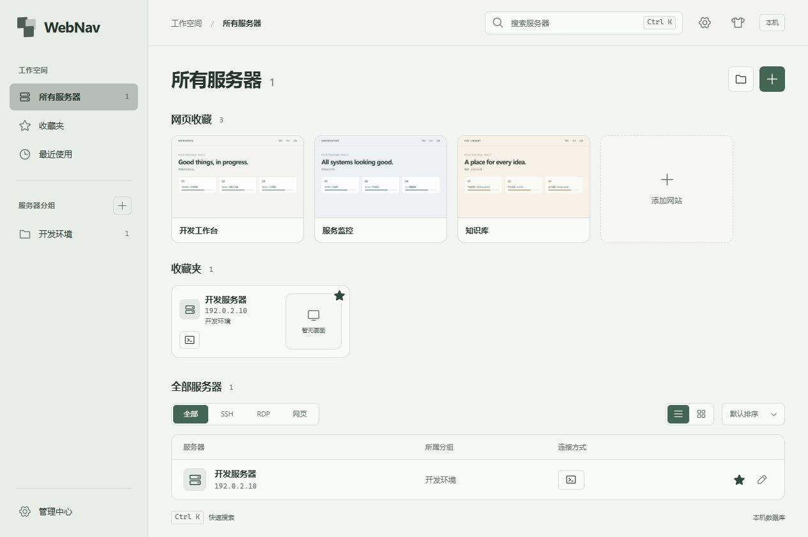

# 网页收藏

首页标题下、服务器收藏夹上方提供独立的网页收藏区，不需要先创建服务器。卡片固定宽度 208px，截图比例 8:5，名称在下方；多了自动换行，行尾保留空白。点击卡片以浏览器新标签页打开网址。卡片悬停、键盘聚焦或触屏时提供查看账密、编辑和刷新截图图标；每个图标有名称和提示。

## 保存与查看

添加时填写名称、HTTP(S) 网址，可选账号与密码；编辑时不回填已有账密，留空保持原字段，也可一起清除。编辑关闭采用拖选保护，有改动时提供保存、不保存和继续编辑。删除需再次点击确认。最多 200 个网页收藏，每个名称最多 60 字、网址 2,048 字、账号 256 字、密码 4,096 字。

已配对的浏览器扩展提供“收藏当前网页”：在网站填好账号密码后点击读取，检查弹窗中的名称、网址及账密再保存，不必回小站重填。默认新增，也可明确选择更新同一网站的已有收藏；不勾选保存账密时只保存页面，更新时保留旧账密。扩展不监听输入或登录提交，不自动上传；保存后首页经现有订阅立即更新，截图仍由独立未登录浏览器生成。

网址不允许嵌入账号密码，也不接受脚本、本机文件或其他非 HTTP(S) 协议。点击网站只负责打开网页，不把账号密码放进 URL。可另行安装并配对[浏览器自动填写扩展](browser-extension.md)，按域名和非默认端口匹配账密（HTTP/HTTPS 共用）；逐网站授权后填写，不自动提交登录。截图浏览器仍保持独立、未登录，不使用扩展或账密。

账号和密码一起存入现有 `credentials` 表，类型为 `web-login`，ID 使用独立命名空间。无主密码时使用 Base64 可逆编码；有主密码时随 SSH / RDP 凭据一起迁移为 scrypt + AES-256-GCM，更换、移除主密码也一起原子迁移。服务器目录的替换或导入不删除网页收藏及其账密。

“查看账号密码”有独立规则：

- 无主密码：点击钥匙直接读取显示。
- 有主密码：每次打开都要重新输入主密码；页面已经解锁也不能跳过。验证不延长全局解锁有效期。
- 验证成功只向该次 WS 请求返回账密，不创建查看通行证，也不进入操作去重缓存、订阅事件、普通配置响应或服务器 JSON 导出。
- 关闭、离开收藏区、断线、锁定或该条记录改变时清除显示的账密，迟到的响应不恢复显示。可手动复制，应用不代替用户清空系统剪贴板。

网页收藏元数据、截图与账密分别保存。元数据和截图不加密；截图仅来自未登录的独立浏览器，不能承诺网站自身页面不包含敏感信息。普通服务器配置导入导出暂不包含这个独立收藏区；本地数据库备份才包含它。

## 网页截图

新增网址或修改网址后排队生成，手动刷新重新抓取；页面刷新、打开收藏或服务启动不会重新访问所有网站。

后端使用 `playwright-core` 连接自己启动的独立无头 Edge / Chrome，优先 Edge。只复用已安装的浏览器程序，不使用用户浏览器标签、个人配置目录、Cookie 或保存的账号密码，也不会自动下载浏览器。每个任务新建隔离上下文，完成或失败后关闭浏览器。

- 截取 960 × 600 首屏 JPEG，质量 50，每张最多 256 KiB，持久化缓存。
- 全局串行队列，同一个网站合并等待任务；整体截图约 20 秒超时，导航 10 秒，页面加载等待有界。
- 修改网址立即移除旧图；旧任务返回时检查记录版本与网址，不允许覆盖新网址的图。
- 手动刷新失败保留同一网址的上次图片；没有图片时显示占位和“截图未能生成”，可以再次刷新。
- 登录、验证码或拦截页会作为当前未登录页面呈现；不绕过认证或证书错误。
- 截图 API 只通过业务 WS 按需返回 JPEG data URL，不在目录推送中塞入图片。前端通过 IntersectionObserver 只加载可见区域附近的图，离开范围释放图片引用，同页最多两个截图读取请求并行。
- 删除时删除缓存与账密、取消对应任务；停服务时取消截图并关闭自己的浏览器，不关闭用户浏览器。

截图总 payload 理论上限约 50 MiB（200 × 256 KiB），不含 SQLite 页、索引、WAL 和截图浏览器运行内存；没有完成上限容量压测。

实现参考：[Playwright 浏览器通道与独立上下文](https://playwright.dev/docs/api/class-browser#browser-new-context)、[截图](https://playwright.dev/docs/screenshots)。

## 数据与通信

`web_bookmarks` 表保存名称、网址、记录版本、预览状态、JPEG 与截图时间，独立于服务器目录。增删改与凭据写入同一 SQLite 事务；编辑和删除携带记录版本，冲突拒绝覆盖。公开列表有单独递增版本和订阅，重连重新取得完整快照。凭据与图片不会出现在公开列表。

具体 RPC 见 [WS 协议](websocket-protocol.md)。截图浏览器不是网页 SSH 或 RDP 的画面提供器，服务器卡片最后画面的占位状态不变。

## 已完成验证

自动测试覆盖元数据与账密事务回滚、操作去重、版本冲突、保存后重启、服务器导入不误删网站账密、主密码每次重新验证及更换/移除时迁移、公开数据不含账密、串行队列、旧网址结果丢弃、失败刷新保留旧图与删除取消任务。前端同时校验网址和公开快照中的字段、版本、重复 ID 与数量上限。

浏览器使用独立数据库、虚构账密和三个本地测试页面，实际通过已安装 Edge 生成截图；已验证新增、删除、编辑保留提示、未保存关闭提示、新标签页打开、错误/正确主密码、关闭再查看重新要求主密码、明暗主题和 390 × 844 窄屏布局，无横向溢出。测试未连接真实服务器，未在用户数据库中添加演示网站。

